# DMW V1.0 软件设计说明书

> **文档类型**：Software Design Description（SDD）  
> **项目**：DCL — DDS Client Libraries  
> **模块**：DMW  
> **版本**：V1.0  
> **状态**：Re-Freeze Candidate  
> **设计语言**：C++17  
> **中间件**：Fast DDS only  
> **源码基线**：`SiYueY/dcl` commit `1e02a0eb2a87c6bfae8f8b0de4b4e8033810eff9`
> **主要兼容线**：ROS 2 Humble / Fast DDS 2.6.x；ROS 2 Jazzy / Fast DDS 2.14.x  
> **文档组织参考**：IEEE 1016 的软件设计说明思想，并结合现代 C++ runtime/library 的接口契约、并发、生命周期、互操作和验证实践  
> **替代关系**：本文在 **V1.0 Frozen** 之后正式 supersede `dmw/docs/dmw.md` 与 `dmw/docs/dmw_fastdds.md`；在 Candidate 阶段两份旧文档仍作为迁移核对来源，不得提前删除

---

# 1. 引言（Introduction）

## 1.1 编写目的

本文定义 DMW V1.0 的统一软件设计、公共行为契约、Fast DDS 实现约束、ROS 2 兼容性边界和验证要求。

它的目标不是复述源码，而是成为以下工作的唯一长期设计沟通媒介：

- DMW V1.0 代码收口与审查；
- `dclcpp`、`dclpy` 对 common runtime 的使用；
- Fast DDS backend 的维护；
- ROS 2 Topic / Service / Action / Graph interoperability；
- 并发、生命周期、teardown 与资源安全审查；
- 单元、集成、stress、sanitizer 和发布验收；
- V1.x correctness/compatibility 维护；
- V2 设计边界判断。

本文必须让一个熟悉 C++17、DDS 和 ROS 2 的开发者能够明确回答：

```text
DMW 负责什么？
DMW 不负责什么？
公共 API 的可观察行为是什么？
每个模块有哪些不变量？
Fast DDS 如何映射？
错误如何返回？
并发和 shutdown 如何线性化？
ROS 2 compatibility 到什么程度？
实现如何验证？
```

## 1.2 范围

本文只描述 `dcl/dmw`。

```text
             C++ Application              Python Application
                    │                             │
                    ▼                             ▼
                 dclcpp                         dclpy
                    │                             │
                    │                           _dclpy
                    │                             │
                    └──────────────┬──────────────┘
                                   ▼
                                  DMW
                                   │
                                   ▼
                               Fast DDS
                                   │
                                   ▼
                               DDSI-RTPS
```

本文覆盖：

- Error / Result；
- Context / Node；
- Arguments / Remapping / RuntimeMode / Naming；
- Clock / Time；
- MessageType / ServiceType / ActionType；
- TypeRegistry / TopicRegistry；
- QoS；
- Publisher / Subscriber / Event；
- Client / Server / RequestId / availability；
- Timer；
- WaitSet / WaitResult / GuardCondition；
- DiscoveryGraph / GraphEvent / ROS 2 graph metadata；
- ActionClient / ActionServer / Goal FSM；
- Parameter common runtime；
- Fast DDS ReturnCode、listener、teardown、locking；
- ROS 2 wire / graph / tooling compatibility；
- requirement traceability；
- testing / release validation。

本文不定义：

- dclcpp typed template API；
- dclpy Python object presentation；
- Future / Promise / Task；
- Executor / CallbackGroup / ThreadPool；
- user callback；
- Python GIL / asyncio；
- typed Action GoalHandle；
- typed Action result cache；
- typed ROS parameter service/event message assembly。

## 1.3 读者对象

- DMW 核心开发者；
- `dclcpp` / `dclpy` 开发者；
- DCL 架构和代码审查者；
- ROS 2 / Fast DDS 兼容性维护者；
- 测试与发布维护者；
- 后续 DMW V2 设计人员。

## 1.4 规范性关键词

- **必须 / MUST**：V1.0 不可违反的设计或 compatibility contract；
- **不得 / MUST NOT**：明确禁止；
- **应该 / SHOULD**：除非存在可审查理由，否则必须遵守；
- **可以 / MAY**：不影响 V1.0 contract 的实现选择。

正文中的模块契约优先于附录导航性摘要。若两处冲突，必须修正文档使其一致，而不是保留两个 authority。

## 1.5 术语与缩写

| 术语 | 含义 |
| --- | --- |
| DCL | DDS Client Libraries |
| DMW | DCL 的 Fast DDS runtime 与 language-neutral common runtime |
| DDS | Data Distribution Service |
| RTPS | Real-Time Publish-Subscribe protocol |
| RMW | ROS Middleware abstraction |
| FQN | Fully Qualified Name |
| GID | Middleware-neutral endpoint identity |
| QoS | Quality of Service |
| ROS Graph | ROS 2 logical Node/entity discovery graph |
| WaitSet | 等待多个 readiness source 的同步原语 |
| Common Runtime | 与语言类型系统无关、由多个 Client Library 共享的运行时 |
| Backing | public facade 背后的内部共享生命周期状态 |
| Candidate | 基于同一 participant 可组合出的 service/action 候选，不代表唯一远端对象 |
| ProtocolFault | wire-visible protocol commit 已发生，但本地协议不变量无法维持 |
| Re-Freeze | V1 原冻结后，因 correctness 和 dclpy 落地补齐 common-runtime contract 后的重新冻结 |

## 1.6 参考资料

### 项目内部

- DCL repository `README.md`
- `dclcpp` design
- `dclpy` design
- `dmw/docs/dmw.md`
- `dmw/docs/dmw_fastdds.md`
- `dmw/include/dmw/*`
- `dmw/src/*`
- `dmw/test/*`
- `dmw/CMakeLists.txt`

### 上游

- ISO/IEC/IEEE 1016:2009
- ISO/IEC 14882:2017
- OMG DDS / DDSI-RTPS
- eProsima Fast DDS 2.14.x
- ROS 2 Jazzy `rmw_fastrtps`
- ROS 2 `rmw_dds_common`
- ROS 2 `rcl`
- ROS 2 `rcl_action`
- ROS 2 `rclcpp`
- ROS 2 `rclpy`
- ROS 2 Humble / Fast DDS 2.6.x

---

# 2. 架构概览（Architecture Overview）

## 2.1 系统上下文

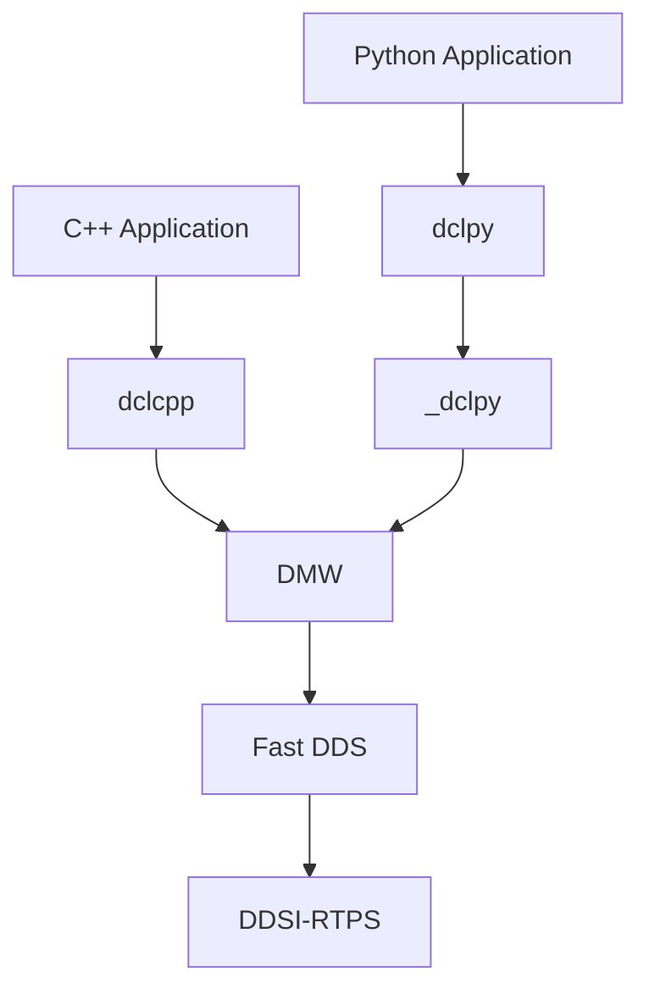

DMW 同时承担：

```text
Fast DDS binding / middleware primitive
+
language-neutral common runtime
```

DMW 不等于 `rmw_fastrtps` 薄包装，也不复制 ROS 2 package tree。

更准确地说：

```text
DMW
≈ rmw / rmw_fastrtps 的 Fast DDS runtime responsibilities
+ rcl 的 language-neutral runtime responsibilities
+ rcl_action 的 language-neutral protocol/state-machine responsibilities
+ 为避免 dclcpp / dclpy 重复而下沉的 common state
```

## 2.2 架构边界

### DMW 是以下能力的唯一 common authority

```text
Context lifecycle
Node logical identity
Arguments / Remapping / name resolution
RuntimeMode / wire naming
Clock / Time
Message / Service / Action runtime type
TypeRegistry / TopicRegistry
QoS profile / actual QoS / compatibility
Topic transport
Service correlation / pending FSM / availability
Timer
WaitSet / readiness
DiscoveryGraph / GraphEvent
ROS2 graph metadata
Action endpoint composition / Goal FSM / cancel / result / expiry
Parameter value / descriptor / store / validation / override
```

### Client Library 负责

```text
C++ templates
Python object model
Future / Promise / Task
Pending Future registry
Executor / callback dispatch
CallbackGroup / ThreadPool
GIL / asyncio
typed Action GoalHandle
typed Action result cache
parameter user callbacks
typed ROS standard-interface message assembly
```

核心原则：

> **DMW 提供 asynchronous communication/readiness primitives，不提供 application execution runtime。**

## 2.3 高层组件

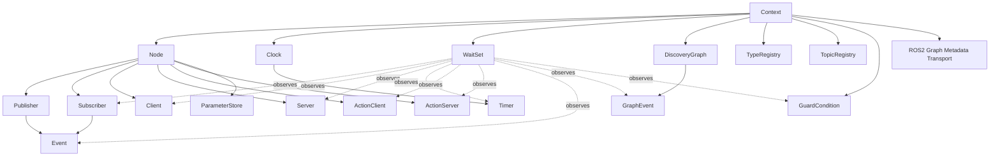

## 2.4 Fast DDS Entity Mapping

| DMW | Fast DDS | 说明 |
| --- | --- | --- |
| Context | 1 DomainParticipant | runtime root |
| Context | 1 DDS Publisher container | Node 共享 |
| Context | 1 DDS Subscriber container | Node 共享 |
| Node | 无 DDS entity | logical identity |
| Publisher | DataWriter | Topic |
| Subscriber | DataReader | Topic |
| Client | request DataWriter + response DataReader | Service |
| Server | request DataReader + response DataWriter | Service |
| Clock | 无 DDS entity | common runtime |
| Timer | 无 DDS entity | logical deadline |
| WaitSet | DDS WaitSet + private control GuardCondition | native + logical |
| Event | endpoint listener state + cursor | persistent observer |
| GraphEvent | DiscoveryGraph revision cursor | logical |
| ActionClient | 3 Service clients + 2 Topic readers = 8 DDS endpoints | 5 logical constituents |
| ActionServer | 3 Service servers + 2 Topic writers = 8 DDS endpoints | 5 logical constituents |
| ParameterStore | 无 DDS entity | Node-local state |

> “Action five endpoints”一词在本文中弃用。规范术语为 **five logical Action constituents/channels**；底层 DDS endpoint 数量为 8。

## 2.5 关键设计决策（ADR Summary）

### ADR-01 — Fast DDS only

DMW V1.0 不提供 middleware plugin abstraction。这样可以直接利用 Fast DDS WaitSet、listener、discovery、SampleIdentity，并避免为不存在的第二 backend 设计最低公分母接口。

### ADR-02 — WaitSet belongs to DMW; Executor does not

readiness 必须跨语言一致；callback scheduling 不应由 middleware runtime 决定。

### ADR-03 — Node is logical identity, not Participant

一个 Context 使用一个 Participant；多个 logical Node 显式通过 graph metadata 传播。

### ADR-04 — Explicit ROS graph metadata

禁止从 Participant name 猜测 Node。ROS2 mode 通过 `ros_discovery_info` compatible metadata 建立 Node ↔ endpoint association。

### ADR-05 — `Result<T>` for expected runtime failures

普通 runtime failure 不使用 exception；`std::bad_alloc` 允许传播。

### ADR-06 — Action common state lives in DMW

Goal FSM、cancel selection、result association、expiry 只实现一次。

### ADR-07 — Parameter store lives in DMW

value/descriptor/store/validation/override/delta 属于 DMW；user callback 留语言层。

### ADR-08 — Availability interruption uses generations

Service/Action availability wait 通过 token + generation 防 lost wakeup。

### ADR-09 — Memory safety over eager reclamation

Fast DDS teardown 无法证明引用已释放时允许 conservative retention，禁止冒险 free。

## 2.6 设计约束

| 项目 | V1.0 约束 |
| --- | --- |
| C++ | C++17 |
| 主要开发兼容基线 | Ubuntu 22.04 / GCC 11 |
| 现代 primary | Jazzy / Fast DDS 2.14.x |
| compatibility baseline | Humble / Fast DDS 2.6.x |
| ROS runtime dependency | 禁止 |
| Middleware | Fast DDS only |
| C++20 / `std::expected` | 禁止 |
| stable C ABI | 不提供 |
| middleware plugin | 不提供 |
| ordinary public Fast DDS type leakage | 禁止 |
| user callback in DMW | 禁止 |
| Executor in DMW | 禁止 |
| per-timer thread | 禁止 |
| fixed periodic WaitSet polling | 正常路径禁止 |
| Component / Composition | V1.0 非目标 |
| YAML parameter-file parser | V1.0 非目标 |

## 2.7 Ownership 与生命周期模型

### Facade vs backing

```text
public facade lifetime
        ≠
internal backing lifetime
```

child backing 持有足够的 Context/Node backing，保证 Context facade 析构不等价于立即销毁 Participant。

### 创建事务

```text
validate
→ allocate common/private state
→ create middleware resources
→ register graph/wait/lifecycle state
→ commit facade
```

失败逆序 rollback；禁止 half-valid public object。

### Context state

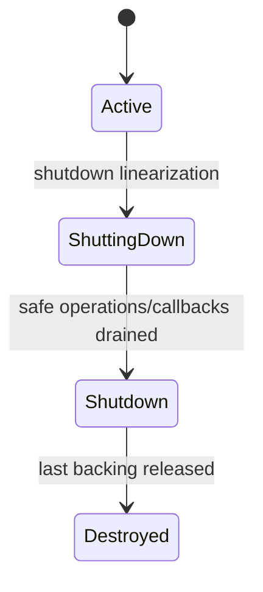

进入 `ShuttingDown` 后：

- 拒绝新 child/resource；
- 拒绝新 middleware operation；
- 唤醒 WaitSet；
- 唤醒 Service/Action availability wait；
- 唤醒 Clock/Timer/Graph logical waits；
- 等待 teardown safety 所需 operation/callback drain；
- 已存在 facade 仍可安全析构。

## 2.8 并发模型

执行上下文至少包括：

```text
application thread
Fast DDS listener thread
WaitSet blocking thread
shutdown / close thread
```

全局规则：

1. listener 不执行 user callback；
2. listener 不执行可能长期阻塞的 protocol work；
3. graph/store/goal lock 内不得执行 user code；
4. 一个 WaitSet 同时最多一个 active `wait()`；
5. topology mutation 与 native wait 通过 handoff 协议同步；
6. shutdown 与新 operation 之间存在明确 admission linearization；
7. availability wait 的 predicate 是 generation，不依赖 notification 时序；
8. finite timeout 使用单一 absolute deadline；
9. Action result Server 与 GoalRegistry mutation 使用固定协调域；
10. Parameter atomic mutation 使用单 store synchronization domain。

## 2.9 错误处理总体原则

全局只冻结少量规则，不建立一个覆盖所有 FSM 的“万能错误排序”。

可安全完成的 request-shape validation 可以先执行，例如 null pointer、invalid bit/name/option。

需要 Context runtime 的 operation 在进入 middleware/common state 前尝试 admission：

```text
Active -> admitted
ShuttingDown / Shutdown -> ContextShutdown
```

进入某个 protocol/FSM 后，由该模块的线性化点决定最终错误。

例如 Action accept：

```text
admission
→ reserve Goal
→ wire response commit
→ local Goal commit
```

因此 wire 已提交后 local invariant 失败必须报告 `ProtocolFault`，不能被稍后发生的 shutdown 覆盖。

## 2.10 ROS 2 Compatibility Model

V1.0 兼容性分为：

```text
wire compatibility
+
graph compatibility
+
tool-visible compatibility
```

Wire：Topic `rt/`、Service `rq/rr` + SampleIdentity、Action 3 Service + 2 Topic。

Graph：ROS 2 peer 能看到 DMW Node，DMW 能看到 ROS 2 Node，Node ↔ endpoint 使用 explicit metadata。

Tool-visible：发布验收应覆盖 `ros2 node/topic/service/action`。

---

# 3. 详细模块设计（Detailed Module Design）


## 3.1 Runtime Foundation：Context 与 Node

### 3.1.1 Responsibility

负责 runtime root、Participant/container ownership、lifecycle、operation admission、Node logical identity、child factory、graph local registration、global Arguments 与 captured QoS baseline。

### 3.1.2 Public Interface and Contract

#### ContextOptions

```cpp
struct ContextOptions
{
    std::uint32_t domain_id{0};
    std::string participant_name;
    RuntimeMode runtime_mode{RuntimeMode::DDS};
    Arguments arguments;
};
```

创建后 `domain_id`、`runtime_mode` 和 global Arguments immutable。

#### Context

```cpp
static Result<std::unique_ptr<Context>>
create(const ContextOptions& options);

std::uint32_t domain_id() const noexcept;
RuntimeMode runtime_mode() const noexcept;
bool is_shutdown() const noexcept;

Result<void> shutdown();

Result<std::unique_ptr<Node>> create_node(const NodeOptions&);
Result<std::unique_ptr<Clock>> create_clock(ClockType);
Result<std::unique_ptr<Timer>> create_timer(Clock&, const TimerOptions&);
Result<std::unique_ptr<GraphEvent>> create_graph_event();
Result<GraphRevision> graph_revision() const;
Result<GraphSnapshot> graph_snapshot() const;
Result<std::unique_ptr<WaitSet>> create_wait_set(const WaitSetOptions&);
Result<std::unique_ptr<GuardCondition>>
create_guard_condition(const GuardConditionOptions&);
```

#### NodeOptions

```cpp
struct NodeOptions
{
    std::string node_name;
    std::string node_namespace{"/"};
    Arguments arguments;
    bool use_global_arguments{true};
    bool allow_undeclared_parameters{false};
};
```

#### Node identity

```cpp
std::string_view name() const noexcept;
std::string_view node_namespace() const noexcept;
std::string_view fully_qualified_name() const noexcept;
```

### 3.1.3 Internal State

Context 概念字段：

```text
lifecycle state
DomainParticipant
DDS Publisher container
DDS Subscriber container
ParticipantListener backing
TypeRegistry
TopicRegistry
DiscoveryGraph
ROS2 GraphMetadataTransport
captured reader/writer QoS baseline
active operation count
shutdown callbacks
child/backing refs
```

### 3.1.4 Context Create Transaction

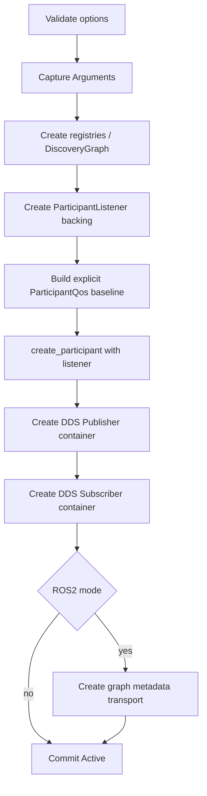

ParticipantListener **必须在 `create_participant()` 时安装**，避免 discovery observation gap。

### 3.1.5 Participant QoS Authority

V1.0 默认不得隐式把下列 process-global configuration 变成 Context contract：

```text
RMW_FASTRTPS_USE_QOS_FROM_XML
RMW_FASTRTPS_PUBLICATION_MODE
caller later mutating Fast DDS global defaults
```

Context 创建时必须 capture 一份明确、可审计的 Participant/entity baseline。

未来若支持 XML/profile override：

- 必须通过显式 DMW option；
- 必须定义 precedence；
- 必须在 Context creation 时 capture；
- 不允许同一 Context 生命周期中语义漂移。

### 3.1.6 Node Create

```text
merge global + local Arguments
→ resolve __node / __ns
→ validate identity
→ allocate NodeState
→ register local graph metadata
→ install ParameterStore / override table
→ commit facade
```

local graph registration 失败 -> Node 创建失败。

### 3.1.7 Lifecycle / Concurrency

- `shutdown()` 重复/并发调用收敛到同一 terminal result；
- shutdown linearization 后不允许新 operation；
- child backing 保持 Context backing；
- Node facade 析构后已有 endpoint 可以继续工作；
- endpoint 保存其所需 Node identity/remap backing；
- graph Node ownership 与 endpoint ownership 分别按真实生命周期更新。

### 3.1.8 Design Invariants

- **FND-INV-01**：一个 Context = 一个 Participant。
- **FND-INV-02**：Node 不等于 Participant。
- **FND-INV-03**：Context/Node 创建 transactional。
- **FND-INV-04**：ParticipantListener 在 Participant 创建时即有效。
- **FND-INV-05**：Node 成功返回前完成 graph registration。
- **FND-INV-06**：Context facade 可先于 child facade 析构。
- **FND-INV-07**：ShuttingDown 后不允许新 middleware/common-state operation。
- **FND-INV-08**：process-global Fast DDS config 不得隐式改变同一 Context contract。

## 3.2 Arguments、Naming 与 RuntimeMode

### 3.2.1 Public Types

```cpp
struct RemapRule
{
    std::string from;
    std::string to;
};

struct ParameterOverride
{
    std::string name;
    std::string value;
};

Result<Arguments>
parse_arguments(const std::vector<std::string>& arguments);
```

### 3.2.2 Remap Semantics

```text
Context global Arguments
        +
Node local Arguments
        ↓
select applicable rules
        ↓
__node / __ns
        ↓
validate normalized Node identity
        ↓
entity namespace expansion
        ↓
topic/service/action remap
        ↓
logical FQN
        ↓
RuntimeMode transport resolver
```

规则：

1. rule 与 namespace expansion 后的原始请求名比较；
2. 不链式应用；
3. 多个匹配时最后一个生效；
4. node-local rule 在 global rule 后，因此覆盖 global；
5. node-scoped rule 只作用于匹配 Node；
6. invalid source name/rule -> `InvalidName`；
7. 未识别参数保留。

### 3.2.3 RuntimeMode

```cpp
enum class RuntimeMode
{
    DDS,
    ROS2
};
```

| Logical `/a/b` | DDS | ROS2 |
| --- | --- | --- |
| Topic | `a/b` | `rt/a/b` |
| Service Request | `a/b_Request` | `rq/a/bRequest` |
| Service Response | `a/b_Reply` | `rr/a/bReply` |

Action logical suffix：

```text
/_action/send_goal
/_action/cancel_goal
/_action/get_result
/_action/feedback
/_action/status
```

前三个走 Service resolver，后两个走 Topic resolver。

### 3.2.4 Invariants

- **NAM-INV-01**：name/remap 只有 DMW 一个 authority。
- **NAM-INV-02**：public observer 返回 logical name。
- **NAM-INV-03**：Action 不复制 `rt/rq/rr` resolver。
- **NAM-INV-04**：Client Library 不重新解析 DMW 已确定的 remap/override semantics。

## 3.3 Type System、Registry 与 QoS

### 3.3.1 Type Contracts

#### Gid

```cpp
struct Gid
{
    static constexpr std::size_t Size = 16;
    std::array<std::uint8_t, Size> data{};
};
```

普通 public Gid 固定 16-byte。它与 ROS graph metadata 不同发行版的 16/24-byte wire field 是不同层次。

#### MessageType

- cheap-copy immutable descriptor；
- `type_name()` = DDS wire type name；
- ordinary runtime header 不暴露 Fast DDS type；
- Fast DDS generated binding 仅在 `dmw/fastdds/message_type.hpp`。

Type identity：

```text
wire type name + BindingIdentity
```

规则：

```text
same wire + same binding -> reuse
same wire + different binding -> TypeMismatch
```

ServiceType = request + response MessageType。

ActionType = 3 ServiceType + feedback/status MessageType。

### 3.3.2 TypeRegistry / TopicRegistry

TypeRegistry key = wire type name。

Topic identity：

```text
resolved DDS topic name + wire type name
```

同 DDS topic name 不同 wire type -> `TypeMismatch`。

Type/Topic backing 只有在所有 endpoint dependency 安全释放后才能 unregister/release。

### 3.3.3 QoS Model

支持 History/Depth、Reliability、Durability、Deadline、Lifespan、Liveliness、Liveliness lease duration。

`QosDuration`：

```text
SystemDefault
Infinite
Finite
```

### 3.3.4 Profiles

| Profile | History | Reliability | Durability |
| --- | --- | --- | --- |
| `ros2_default` | KeepLast(10) | Reliable | Volatile |
| `ros2_services_default` | KeepLast(10) | Reliable | Volatile |
| `ros2_sensor_data` | KeepLast(5) | BestEffort | Volatile |
| `ros2_parameters` | KeepLast(1000) | Reliable | Volatile |
| `ros2_parameter_events` | KeepLast(1000) | Reliable | Volatile |
| `ros2_action_status_default` | KeepLast(1) | Reliable | TransientLocal |

`SystemDefault` 与 `ros2_default()` 不同。

### 3.3.5 ROS2 Endpoint Baseline

ROS2 mode implementation baseline：

```text
history_memory_policy = PREALLOCATED_WITH_REALLOC_MEMORY_MODE
data_sharing          = OFF
publication_mode      = SYNCHRONOUS_PUBLISH_MODE
```

这些不进入普通 `dmw::Qos`。

### 3.3.6 actual_qos

必须从真实 DataWriter/DataReader effective QoS reverse-map。

无法可靠获得的 public field 使用 SystemDefault/unknown contract，不得返回 requested value 冒充 actual。

### 3.3.7 Compatibility

`check_qos_compatibility()` 是 DMW-owned pure helper，返回 Compatible / Warning / Incompatible，并提供稳定 reason。

### 3.3.8 Invariants

- **TYP-INV-01**：普通 public header 不泄漏 Fast DDS/Fast CDR concrete type。
- **TYP-INV-02**：same wire name + different binding -> `TypeMismatch`。
- **TYP-INV-03**：QoS profile 只有 DMW 一个 authority。
- **TYP-INV-04**：actual QoS 来自真实 entity。
- **TYP-INV-05**：Fast DDS minor 差异只存在 private shim。

## 3.4 Topic Communication 与 Event

### 3.4.1 Publisher Interface

```cpp
Result<void> write(const void* message);
std::string_view topic_name() const noexcept;
const MessageType& message_type() const noexcept;
Result<Qos> actual_qos() const;
Result<std::size_t> matched_subscriber_count() const;
Result<bool> wait_for_all_acked(WaitTimeout timeout);
Result<void> assert_liveliness();
Result<std::unique_ptr<Event>> create_event(EventType type);
```

### 3.4.2 Subscriber Interface

```cpp
Result<bool> read(void* message, MessageInfo& info);
std::string_view topic_name() const noexcept;
const MessageType& message_type() const noexcept;
Result<Qos> actual_qos() const;
Result<std::size_t> matched_publisher_count() const;
Result<std::unique_ptr<Event>> create_event(EventType type);
```

### 3.4.3 Write / Read

Write：

```text
validate non-null
→ Context admission
→ DataWriter::write
→ ReturnCode mapping
```

Read：

```text
snapshot unread_count
→ bounded candidate loop
→ take
→ invalid sample consumes budget
→ TemporarySample
→ deserialize/commit
```

规则：

- concurrent arrival 不延长当前 read 的 budget；
- `success + false` 不修改 caller output；
- sample consume 前 Error 不修改 output；
- sample 已 consume 后 conversion Error 只保证 caller object 可安全析构，内容可 unspecified。

### 3.4.4 MessageInfo

```cpp
struct MessageInfo
{
    Gid writer_gid{};
    std::int64_t writer_timestamp{0};
    std::uint64_t to_writer_sequence{0};
    std::int64_t reader_timestamp{0};
};
```

不可获得时使用 unknown contract，不用本地 clock 伪造 DDS timestamp。

### 3.4.5 Matched Count

必须来自 PublicationMatchedStatus / SubscriptionMatchedStatus，不能从 Graph 同名 endpoint count 推导。

### 3.4.6 `wait_for_all_acked()`

```text
ack complete -> success + true
poll/finite deadline -> success + false
shutdown -> ContextShutdown
```

Fast DDS blocking call 不可取消时，可使用 bounded private slices 获得 shutdown responsiveness，但所有 slice 受同一个 absolute deadline 控制。不得重置 timeout，也不得演变成 public fixed polling semantics。

### 3.4.7 EventType

Subscriber：

```text
LivelinessChanged
RequestedDeadlineMissed
RequestedIncompatibleQos
MessageLost
```

Publisher：

```text
LivelinessLost
OfferedDeadlineMissed
OfferedIncompatibleQos
```

父类型不支持的 EventType -> `InvalidArgument`。

### 3.4.8 EventInfo

`QosPolicyKind` 的公开枚举值固定为：

```cpp
enum class QosPolicyKind
{
    Unknown,
    History,
    Reliability,
    Durability,
    Deadline,
    Lifespan,
    Liveliness
};
```

Event payload：

```cpp
struct DeadlineMissedInfo
{
    std::int32_t total_count{0};
    std::int32_t total_count_change{0};
};

struct LivelinessLostInfo
{
    std::int32_t total_count{0};
    std::int32_t total_count_change{0};
};

struct LivelinessChangedInfo
{
    std::int32_t alive_count{0};
    std::int32_t not_alive_count{0};
    std::int32_t alive_count_change{0};
    std::int32_t not_alive_count_change{0};
};

struct IncompatibleQosInfo
{
    std::int32_t total_count{0};
    std::int32_t total_count_change{0};
    QosPolicyKind last_policy{QosPolicyKind::Unknown};
};

struct MessageLostInfo
{
    std::size_t total_count{0};
    std::size_t total_count_change{0};
};
```

`EventInfo` 的 variant alternatives **及顺序**属于 public binding contract：

```cpp
using EventInfo = std::variant<
    DeadlineMissedInfo,
    LivelinessLostInfo,
    LivelinessChangedInfo,
    IncompatibleQosInfo,
    MessageLostInfo>;
```

`EventType -> EventInfo alternative` 映射固定为：

| EventType | EventInfo alternative |
| --- | --- |
| `LivelinessChanged` | `LivelinessChangedInfo` |
| `RequestedDeadlineMissed` | `DeadlineMissedInfo` |
| `RequestedIncompatibleQos` | `IncompatibleQosInfo` |
| `MessageLost` | `MessageLostInfo` |
| `LivelinessLost` | `LivelinessLostInfo` |
| `OfferedDeadlineMissed` | `DeadlineMissedInfo` |
| `OfferedIncompatibleQos` | `IncompatibleQosInfo` |

Client Library / language binding 不得依赖 `std::variant::index()` 以外的隐式实现顺序猜测；若需要稳定跨语言分派，应首先使用 `Event::type()`，再按上表读取唯一合法 alternative。

### 3.4.9 Event Cursor Contract

Factory 创建时 capture 当前 cumulative source state 为 cursor，因此创建前 history 不 replay。

规则：

- 每个 Event 独立 cursor；
- WaitSet ready 不消费 Event；
- successful `Event::take()` 才推进 cursor；
- no change -> `success + false`，output 不变；
- parent destroyed + Context active -> `ParentDestroyed`；
- Context shutdown -> `ContextShutdown`；
- Event identity/generation exhaustion -> `ResourceExhausted`；
- 多个 Event 不得因 Fast DDS destructive status query 互相吞状态；
- `total_count` 是累计状态，`*_change` 是相对该 Event 上次 cursor 的增量。

### 3.4.10 Invariants

- **TOP-INV-01**：Topic read 的 `success + false` 不修改输出。
- **TOP-INV-02**：单次 read candidate budget 有界。
- **TOP-INV-03**：matched count 取真实 middleware state。
- **EVT-INV-01**：Event 创建前历史不 replay。
- **EVT-INV-02**：WaitSet readiness 不消费 Event。
- **EVT-INV-03**：Event cursor 独立。
- **EVT-INV-04**：parent teardown 可观察为 `ParentDestroyed`。


## 3.5 Service Communication

### 3.5.1 Public Interface

#### Client

```cpp
Result<RequestId> write_request(const void* request);
Result<bool> read_response(void* response, RequestId& request_id);

Result<bool> service_is_available() const;
Result<bool> wait_for_service(WaitTimeout timeout) const;

Result<AvailabilityWaitToken> prepare_availability_wait() const;
Result<void> interrupt_waits();

Result<bool> wait_for_service(
    WaitTimeout timeout,
    const AvailabilityWaitToken& token) const;

Result<Qos> request_actual_qos() const;
Result<Qos> response_actual_qos() const;

std::string_view service_name() const noexcept;
```

#### Server

```cpp
Result<bool> read_request(void* request, RequestId& request_id);
Result<void> write_response(const RequestId&, const void* response);
Result<void> discard_request(const RequestId&);

Result<Qos> request_actual_qos() const;
Result<Qos> response_actual_qos() const;

std::string_view service_name() const noexcept;
```

#### ServerOptions

```cpp
struct ServerOptions
{
    std::size_t max_pending_requests{1024};
};
```

`max_pending_requests` **必须 > 0**；0 -> `InvalidArgument`。

### 3.5.2 RequestId

```cpp
struct RequestId
{
    Gid client_gid{};
    std::int64_t sequence_number{0};
};
```

ROS2 mode：

```text
client_gid = client response reader identity
sequence_number = request sample sequence
```

### 3.5.3 ROS2 Correlation

Client request write：

```text
WriteParams.related_sample_identity.writer_guid
    = response reader GUID
```

Server response：

```text
response related_sample_identity
    = original request sample identity
```

### 3.5.4 Pending Capacity

容量包括：

```text
Reserved + Pending + Responding
```

必须在 destructive DDS take 前 reservation。

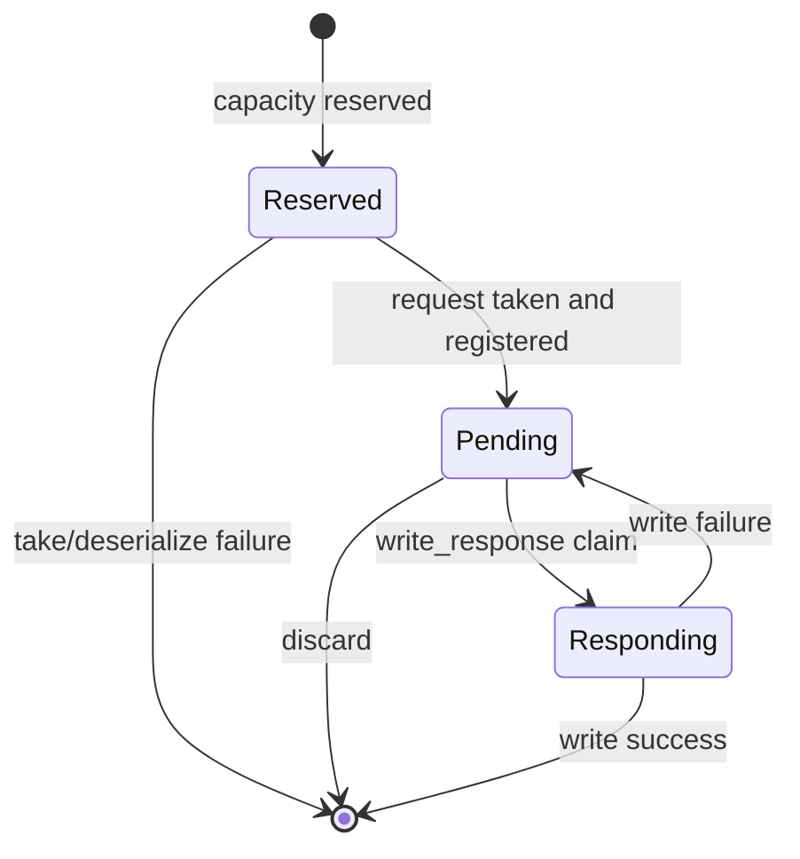

规则：

- `Reserved + Pending + Responding >= max` -> `ResourceExhausted`，不消费 DDS sample；
- duplicate RequestId 在 Pending/Responding 生命周期内必须抑制；
- 不保存无限 responded tombstone；
- unknown/already-completed -> `NotFound`；
- concurrent response to same Responding request -> `Busy`；
- write failure -> Pending，允许 retry；
- shutdown admission 失败 -> `ContextShutdown`。

### 3.5.5 Response Target Match

deadline 来源：

```text
response writer effective reliability.max_blocking_time
```

转换为一个 absolute steady deadline。

状态：

```text
already matched          -> write
matched before deadline  -> write
confirmed gone           -> success without write
deadline expires         -> Timeout
shutdown                  -> ContextShutdown
```

禁止 fixed `100ms` hard-code。

### 3.5.6 Availability Candidate

Server candidate 至少要求同一 remote participant 的：

```text
request DataReader
+
response DataWriter
```

并验证 logical service name、request/response wire type 和当前 availability 定义要求的 QoS compatibility。

若两端都有 Node association，则应要求 Node association 一致。

**能力边界**：

> 该结果只能证明存在 **participant-consistent server candidate**。在没有额外 object identity metadata 时，不得声称发现了一个可唯一标识的 remote Server，不得生成虚构 server GID。

### 3.5.7 Availability Wait

`service_is_available()` 与 `wait_for_service()` 使用同一 DiscoveryGraph authority。

```text
available before timeout -> success + true
finite timeout           -> success + false
Context shutdown         -> ContextShutdown
```

不使用 sleep polling。

### 3.5.8 AvailabilityWaitToken

Token 表达：

```text
endpoint identity
+
captured interruption generation
```

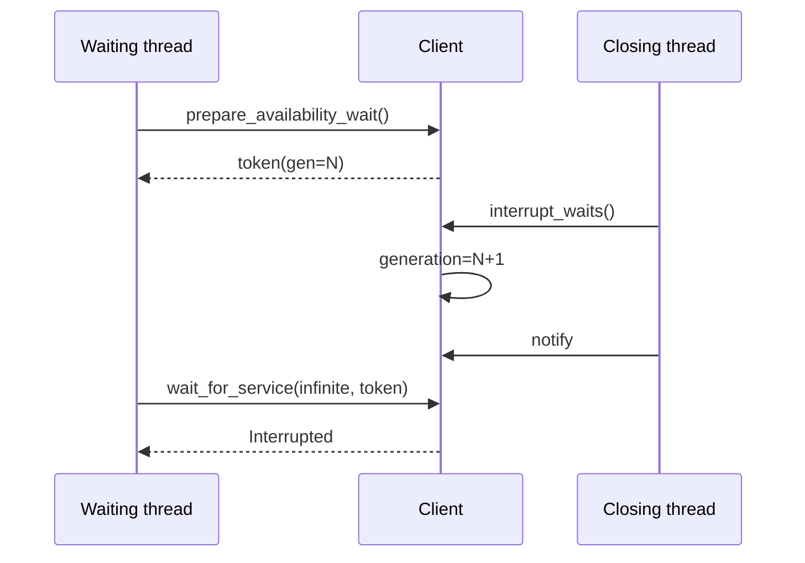

规则：

- token 只能用于创建它的 endpoint；
- wrong endpoint -> `InvalidArgument`；
- token 不延长 endpoint 生命周期；
- stale generation -> `Interrupted`；
- discovery revision -> recheck；
- finite timeout 保持原 absolute deadline；
- Context shutdown -> `ContextShutdown`。

### 3.5.9 discard_request

```text
Pending -> remove, no wire response
Responding -> Busy
unknown/completed -> NotFound
```

discard 必须释放 bounded capacity 并恢复 request-reader eligibility。

### 3.5.10 Invariants

- **SVC-INV-01**：capacity reservation 在 destructive take 前。
- **SVC-INV-02**：Reserved/Pending/Responding 都计入上限。
- **SVC-INV-03**：同一 pending RequestId 同时最多一个 response claim。
- **SVC-INV-04**：response write failure 恢复 Pending。
- **SVC-INV-05**：discard 释放 capacity。
- **SVC-INV-06**：availability candidate 不跨 participant。
- **SVC-INV-07**：candidate 不等于唯一 remote Server。
- **SVC-INV-08**：availability interruption 不 lost wakeup。

## 3.6 Clock and Timer

### 3.6.1 Public Types

```cpp
enum class ClockType
{
    System,
    Steady,
    Ros
};

struct TimePoint
{
    std::int64_t nanoseconds{0};
    ClockType clock_type{ClockType::System};
};

struct TimerOptions
{
    std::chrono::nanoseconds period{0};
    bool autostart{true};
};

struct TimerInfo
{
    TimePoint expected_call_time;
    TimePoint actual_call_time;
    std::chrono::nanoseconds elapsed_since_last_call{0};
};
```

`TimerInfo` 只在一次成功的 `Timer::consume()` 中提交：

- `expected_call_time`：本次被消费的计划 deadline，`clock_type` 与 Timer 绑定的 Clock 一致；
- `actual_call_time`：`consume()` 成功线性化时读取到的实际 Clock 时间；
- `elapsed_since_last_call`：相对上一次成功 consume/reset 建立的 `last_call` 时间的饱和差值；
- `consume()` 返回 `success + false` 时 caller 提供的 `TimerInfo` **不得修改**。

### 3.6.2 Clock Contract

- System -> realtime/system；
- Steady -> monotonic；
- Ros override disabled -> follow system；
- Ros override enabled -> only explicit `set_ros_time()`；
- ROS-time update/enable change 必须唤醒依赖 WaitSet；
- Clock 不执行 jump user callback。

### 3.6.3 Timer Contract

```text
period < 0 -> InvalidArgument
period == 0 -> always-ready while active
readiness -> level-triggered until consume()
missed cycles -> skip and re-align
```

Timer 没有 DDS entity，没有 worker thread，不执行 callback。

一次成功 `consume()` 的 `TimerInfo` 必须同时提供：

```text
expected_call_time
actual_call_time
elapsed_since_last_call
```

三者的 `clock_type`/时间基准必须与 Timer 所绑定 Clock 一致。

Clock facade 可早于 Timer facade 析构；Timer backing 持有 Clock backing。

### 3.6.4 Invariants

- **CLK-INV-01**：Timer 无 per-timer thread。
- **CLK-INV-02**：Timer 不执行 user callback。
- **CLK-INV-03**：Ros override 时不按 steady elapsed 自动推进。
- **CLK-INV-04**：missed cycles 不逐次 replay。
- **CLK-INV-05**：Clock update 可唤醒 blocking WaitSet。

## 3.7 Wait、WaitResult 与 GuardCondition

### 3.7.1 Waitable Kinds

```text
Subscriber
Client
Server
Timer
ActionClient
ActionServer
Event
GraphEvent
GuardCondition
```

### 3.7.2 Public Interface

```cpp
Result<WaitableRegistration> add(...);
Result<void> remove(WaitableRegistration);
Result<void> set_interest(
    WaitableRegistration registration,
    std::uint32_t detail_mask);
Result<WaitResult> wait(WaitTimeout timeout);
```

### 3.7.3 WaitTimeout

```text
Poll
Finite
Infinite
```

Finite 必须 > 0。

Finite wait 在调用开始时计算一个 absolute steady deadline。

所有 control wake、topology change、graph change、timer wake、action expiry、clock update 都只触发 recheck，不得重置 caller deadline。

超大 duration 使用 saturating arithmetic，禁止 overflow。

Fast DDS native duration 上限不足时可 clamp 单次 native wait，但 caller deadline 不变。

### 3.7.4 WaitSet Algorithm

```text
logical readiness pre-check
→ compute user deadline
→ compute Timer/Action runtime deadline
→ reconcile native Conditions
→ native wait(min deadlines)
→ wake
→ topology/shutdown check
→ logical post-check
```

正常路径不得 fixed periodic polling。

### 3.7.5 Registration Contract

- 一个 waitable 同时最多属于一个 WaitSet；
- duplicate add -> `AlreadyRegistered`；
- token 绑定创建它的 WaitSet；
- wrong WaitSet token -> `InvalidArgument`；
- stale token -> `NotRegistered`；
- WaitSet 不拥有 entity；
- entity destructor 自动 detach；
- add/remove 可以与 active wait 并发；
- 一个 WaitSet 同时最多一个 active wait，第二个 -> `Busy`；
- WaitSet destructor 不允许与自身 active wait 无同步并发。

### 3.7.6 ReadyWaitable / WaitResult

```cpp
struct ReadyWaitable
{
    WaitableRegistration registration;
    WaitableKind kind;
    std::uint32_t detail_mask;
};
```

```text
WaitStatus::Ready
    -> ready() MUST NOT be empty

WaitStatus::Timeout
    -> ready() MUST be empty
```

`WaitResult` 是形成时的 immutable readiness snapshot。

snapshot 形成后 remove/destroy 可以让 registration stale。Client Library Executor 必须通过自身 token→entity 映射处理 stale token。

### 3.7.7 Detail Bits

普通 waitable：

```text
kWaitableReadyBit
```

ActionClient：

```text
kActionGoalResponseBit
kActionCancelResponseBit
kActionResultResponseBit
kActionFeedbackBit
kActionStatusBit
```

ActionServer：

```text
kActionGoalRequestBit
kActionCancelRequestBit
kActionResultRequestBit
kActionGoalExpiredBit
```

对一次 `wait()`，Executor 应优先使用 WaitResult detail snapshot，而不是随后重新查询 `readiness()`。

### 3.7.8 `set_interest()`

V1.0 只支持 `WaitableKind::ActionServer`。

- 非 ActionServer -> `Unsupported`；
- unknown bit -> `InvalidArgument`；
- masked reader native condition 不 attach；
- masked unread sample 不消费；
- 恢复 interest 后仍可观察；
- expiry bit 未启用时，goal expiry 不参与该 registration runtime deadline。

### 3.7.9 GuardCondition

使用：

```text
logical trigger generation
+
coalesced pending flag
+
native/internal wake
```

语义：

- trigger before WaitSet registration 可观察；
- 多次 trigger 在消费前可合并为一次 readiness；
- WaitSet 报告 GuardCondition ready 时消费当前 pending trigger；
- trigger 与 consume 并发时，新 generation 不得丢失；
- generation exhaustion -> `ResourceExhausted`；
- Context shutdown -> `ContextShutdown`；
- native trigger/wake failure -> `DDSError`；
- native failure 不得伪装为 success。

### 3.7.10 Invariants

- **WAIT-INV-01**：正常 WaitSet path 无 fixed polling slice。
- **WAIT-INV-02**：finite timeout 使用单一 absolute deadline。
- **WAIT-INV-03**：topology/control wake 不重置 deadline。
- **WAIT-INV-04**：一个 WaitSet 最多一个 active wait。
- **WAIT-INV-05**：WaitSet 不拥有 waitable。
- **WAIT-INV-06**：WaitResult 是 immutable snapshot。
- **WAIT-INV-07**：snapshot token 允许随后 stale。
- **WAIT-INV-08**：GuardCondition concurrent trigger/consume 不 lost wakeup。


## 3.8 Discovery、Graph 与 ROS 2 Graph Metadata

### 3.8.1 Responsibility

负责 participant/endpoint discovery、local Node/entity association、GraphRevision、GraphSnapshot、GraphEvent、Service/Action candidate 和 `ros_discovery_info` transport。

### 3.8.2 Public Graph Types

```cpp
using GraphRevision = std::uint64_t;

struct NodeGraphInfo
{
    std::string node_name;
    std::string node_namespace;
};
```

Topic：

```cpp
enum class EndpointKind
{
    Publisher,
    Subscriber
};

struct TopicEndpointInfo
{
    Gid endpoint_gid{};
    EndpointKind kind{EndpointKind::Publisher};
    std::string node_name;
    std::string node_namespace;
    std::string topic_name;
    std::string wire_type;
    Qos qos;
};

struct TopicGraphInfo
{
    std::string topic_name;
    std::vector<std::string> wire_types;
    std::size_t publisher_count{0};
    std::size_t subscriber_count{0};
};
```

若无法证明 Node association：

```text
node_name = empty
node_namespace = empty
```

禁止猜 Participant name。

Service：

```cpp
enum class ServiceEndpointKind
{
    Client,
    Server
};

struct ServiceEndpointInfo
{
    ServiceEndpointKind kind;
    std::string node_name;
    std::string node_namespace;
    std::string service_name;
    Gid request_endpoint_gid;
    Gid response_endpoint_gid;
    std::string request_wire_type;
    std::string response_wire_type;
};

struct ServiceGraphInfo
{
    std::string service_name;
    std::vector<std::string> request_wire_types;
    std::vector<std::string> response_wire_types;
    std::size_t client_candidate_count;
    std::size_t server_candidate_count;
};
```

Action：

```cpp
enum class ActionEndpointKind
{
    Client,
    Server
};

struct ActionEndpointInfo
{
    ActionEndpointKind kind;
    std::string node_name;
    std::string node_namespace;
    std::string action_name;
    std::vector<Gid> endpoint_gids;
};

struct ActionGraphInfo
{
    std::string action_name;
    std::size_t client_candidate_count;
    std::size_t server_candidate_count;
};
```

`ActionEndpointInfo::endpoint_gids` 是固定顺序的八个 physical DDS
endpoint：SendGoal request、SendGoal response、CancelGoal request、CancelGoal
response、GetResult request、GetResult response、Feedback、Status。Server
candidate 的方向依次为 reader/writer/reader/writer/reader/writer/writer/writer；
Client candidate 则为 writer/reader/writer/reader/writer/reader/reader/reader。
Graph candidate 只表达结构完整性；`ActionClient::server_is_available()` 还必须以当前
client 的 endpoint QoS 验证通信兼容性。

Snapshot：

```cpp
struct GraphSnapshot
{
    GraphRevision revision;
    std::vector<NodeGraphInfo> nodes;
    std::vector<TopicGraphInfo> topics;
    std::vector<TopicEndpointInfo> topic_endpoints;
    std::vector<ServiceGraphInfo> services;
    std::vector<ServiceEndpointInfo> service_endpoints;
    std::vector<ActionGraphInfo> actions;
    std::vector<ActionEndpointInfo> action_endpoints;
};

struct GraphChangeInfo
{
    GraphRevision previous_revision;
    GraphRevision current_revision;
};
```

### 3.8.3 DiscoveryGraph

一个 Context 只有一个 authority：

```text
RemoteParticipantRecord
RemoteEndpointRecord
RemoteNodeRecord
LocalNodeRecord
ServiceCandidateRecord
ActionCandidateRecord
GraphRevision
```

mutation：

```text
normalize
→ compare
→ no observable change => no-op
→ commit
→ revision++
→ collect wake targets
→ unlock
→ wake
```

### 3.8.4 GraphRevision

只有 public-observable graph state 真正变化时增长。

不得增长：

- duplicate Added；
- remove absent endpoint；
- identical remote metadata snapshot；
- callback ordering change with same visible state。

overflow：

```text
terminal runtime condition
MUST NOT silently wrap
```

实现可以使后续 graph mutation/query 进入 `ResourceExhausted` 或等价 terminal internal failure，但不得让 cursor ABA。

### 3.8.5 Local Node ↔ Endpoint Authority

Context 显式保存：

```text
Participant
  ↓
Node(name, namespace)
  ↓
local endpoint Gids
```

一个 Participant 可包含多个 logical Node。

endpoint transaction commit 后增加 association；真实销毁/rollback 后移除。

### 3.8.6 `ros_discovery_info` Wire Contract

ROS2 mode 创建 internal metadata Writer/Reader：

```text
topic = ros_discovery_info
```

该 topic **不得**经过普通 ROS namespace prefix/remapping：

```text
NOT rt/ros_discovery_info
```

payload：

```text
wire-compatible ParticipantEntitiesInfo semantics
```

Writer QoS：

```text
KeepLast(1)
Reliable
TransientLocal
```

Reader QoS：

```text
KeepAll
Reliable
TransientLocal
```

internal metadata endpoints 不暴露给 user Publisher/Subscriber，也不进入 user TopicGraph。

### 3.8.7 GID Wire Layout

```text
Humble           : char[24]
Rolling / Jazzy  : char[16]
```

Build-time option：

```text
DMW_RMW_GID_SIZE
```

默认策略：

```text
fastrtps/Fast DDS < 2.13 -> 24
>= 2.13                 -> 16
```

一次 DMW build 只支持一种 metadata GID layout。

前 16 octets 对应 DDS GUID，因此普通 public Gid 保持 16-byte。

### 3.8.8 Metadata Receive / Drain

Listener thread：

```text
mark pending
+
wake
```

不得在 Fast DDS callback thread 直接执行可能阻塞的 sample drain。

graph_snapshot / graph_revision / availability query 等需要刷新 metadata 的路径应该无条件尝试 bounded drain，不能让 pending flag 成为唯一 gate。

原因：

> DATA_AVAILABLE edge 与 sample 真正入队可能存在时序差，只用 edge gate 可能永久漏读。

单次 drain：

```text
snapshot unread_count at entry
→ bounded ingest
```

防止无法消费样本造成无限 loop。

### 3.8.9 Remote Snapshot Semantics

收到 remote metadata：

1. validate message/participant identity；
2. ignore local participant；
3. normalize Node name/namespace；
4. replace/update该 participant 的完整 snapshot；
5. compare public view；
6. real change -> revision++；
7. wake graph/service/action waiters。

remote metadata 不触发本端 snapshot republish。

identical snapshot 不推进 revision。

### 3.8.10 Metadata Publish Transaction

本地 graph 变化：

```text
commit local graph truth
→ revision++
→ build complete local snapshot
→ publish metadata
→ wake local observers
```

publish failure：

- 不 rollback 已成功创建/删除的 local communication entity；
- local GraphSnapshot 仍反映真实 local state；
- metadata transport 标记 degraded；
- 记录 diagnostic；
- remote ROS graph 可能暂时 stale；
- 后续 local metadata change 或 retry opportunity 发布完整 snapshot；
- 不依赖 delta replay。

### 3.8.11 Service Candidate

同 participant：

```text
request reader
+
response writer
```

logical name/type/QoS compatible。

metadata 可用时进一步要求一致 Node association。

不生成虚构 server GID。

### 3.8.12 Action Candidate

ActionServer candidate 要求同 participant：

```text
SendGoal request reader + response writer
CancelGoal request reader + response writer
GetResult request reader + response writer
Feedback writer
Status writer
```

即：

```text
5 logical constituents
8 DDS endpoints
```

必须校验 logical suffix/name、wire type、当前 availability 所需 QoS compatibility；metadata 可用时进一步要求一致 Node association。

同样只承诺 candidate，不承诺唯一 remote Action object。

### 3.8.13 GraphEvent

- 创建时 cursor = current revision；
- 不 replay 创建前 graph changes；
- `revision > cursor` -> level-ready；
- WaitSet ready 不推进 cursor；
- `take()` 返回 previous/current 并推进 cursor；
- no change -> `success + false`；
- Context shutdown -> `ContextShutdown`；
- destroy while registered 自动 detach。

### 3.8.14 Invariants

- **GRF-INV-01**：DiscoveryGraph 是唯一 authority。
- **GRF-INV-02**：revision only on observable change。
- **GRF-INV-03**：revision 不 silent wrap。
- **GRF-INV-04**：Node identity 不从 Participant name 猜测。
- **GRF-INV-05**：internal metadata topic 不进入 user graph。
- **GRF-INV-06**：metadata listener 不 blocking drain。
- **GRF-INV-07**：metadata query/drain 不仅依赖 pending edge。
- **GRF-INV-08**：metadata publish failure 不 rollback local entity。
- **GRF-INV-09**：candidate ≠ unique remote object。

## 3.9 Action

### 3.9.1 Options

#### ActionClientOptions

```cpp
struct ActionClientOptions
{
    Qos goal_service_qos{Qos::ros2_services_default()};
    Qos cancel_service_qos{Qos::ros2_services_default()};
    Qos result_service_qos{Qos::ros2_services_default()};
    Qos feedback_topic_qos{Qos::ros2_default()};
    Qos status_topic_qos{Qos::ros2_action_status_default()};
};
```

#### ActionServerOptions

```cpp
struct ActionServerOptions
{
    Qos goal_service_qos{Qos::ros2_services_default()};
    Qos cancel_service_qos{Qos::ros2_services_default()};
    Qos result_service_qos{Qos::ros2_services_default()};
    Qos feedback_topic_qos{Qos::ros2_default()};
    Qos status_topic_qos{Qos::ros2_action_status_default()};

    std::chrono::nanoseconds result_timeout{
        std::chrono::seconds(10)
    };
};
```

`result_timeout < 0` 必须拒绝。

### 3.9.2 Common Types

```cpp
struct GoalId
{
    std::array<std::uint8_t, 16> data{};
};

struct GoalInfo
{
    GoalId goal_id{};
    std::chrono::nanoseconds accepted_stamp{0};
};
```

`accepted_stamp` 是 ROS Action cancel-before semantics 使用的 protocol timestamp，不是 result expiry deadline。

```cpp
enum class GoalState
{
    Unknown,
    Accepted,
    Executing,
    Canceling,
    Succeeded,
    Canceled,
    Aborted
};

enum class GoalEvent
{
    Execute,
    CancelGoal,
    Succeed,
    Abort,
    Canceled
};

enum class GoalAcceptMode
{
    Defer,
    Execute
};

struct GoalTransition
{
    GoalState previous;
    GoalState current;
    bool became_terminal;
};

struct GoalStatusInfo
{
    GoalInfo goal_info;
    GoalState state;
};

enum class ResultRequestDisposition
{
    UnknownGoal,
    Pending,
    Terminal
};
```

### 3.9.3 Goal FSM

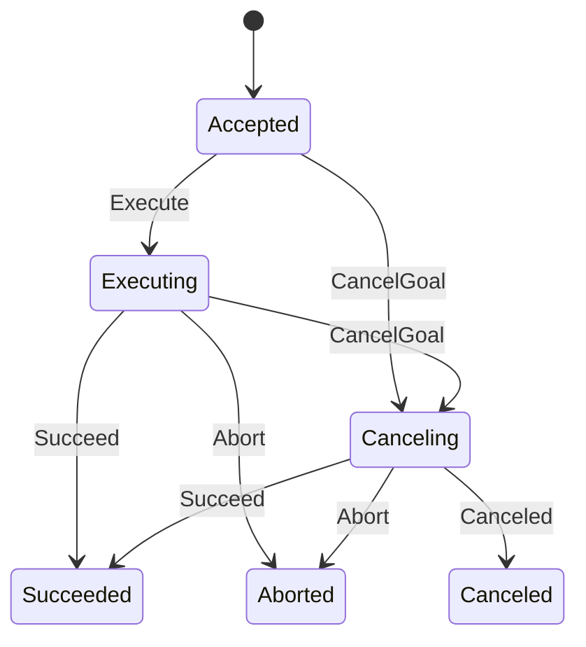

terminal：Succeeded / Canceled / Aborted。

cancelable：Accepted / Executing。

未列出的 transition -> `InvalidState`。

### 3.9.4 Readiness Types

```cpp
struct ActionClientReadySet
{
    bool goal_response;
    bool cancel_response;
    bool result_response;
    bool feedback;
    bool status;
};

struct ActionServerReadySet
{
    bool goal_request;
    bool cancel_request;
    bool result_request;
    bool goal_expired;
};
```

与 WaitResult detail bits 一一对应。

### 3.9.5 Accept Transaction

raw `write_goal_response()` 只允许用于 rejected/non-accepted response。

accepted：

```text
Context admission
→ reserve GoalId
→ write accepted response
→ commit GoalRecord
```

规则：

- duplicate GoalId -> `AlreadyExists`；
- reservation allocation 在 wire write 前；
- response write failure -> rollback reservation；
- successful wire response 后 local commit 设计为 allocation-free/no-fail；
- reservation 在 wire commit 后异常丢失 -> `ProtocolFault`；
- `ProtocolFault` 不得被后发生的 shutdown/object-local error 覆盖。

### 3.9.6 CancelGoalCriteria

```cpp
struct CancelGoalCriteria
{
    GoalId goal_id{};
    std::chrono::nanoseconds stamp{0};
};
```

zero GoalId = wildcard；zero stamp = no time bound；stamp < 0 -> `InvalidArgument`。

四种规则：

| GoalId | Stamp | Selection |
| --- | --- | --- |
| zero | zero | all cancelable goals |
| exact | zero | exact matching cancelable goal |
| zero | non-zero | cancelable goals with `accepted_stamp <= stamp` |
| exact | non-zero | exact matching goal OR cancelable goals with `accepted_stamp <= stamp` |

只选择 committed + cancelable Goal。

结果按 `accepted_stamp` 排序以获得 deterministic output。

`CancelSelection` 只做 common candidate selection；user cancel callback 属于 Client Library。

### 3.9.7 Result Request

active Goal -> Pending；terminal Goal -> Terminal；unknown/expired -> UnknownGoal。

同一个 RequestId 最多关联一个 Goal；重复关联 -> `AlreadyExists`。

### 3.9.8 Result Server / GoalRegistry Coordination

不能存在两个独立漂移 authority。

跨 Result Server pending state 与 GoalRegistry 的操作使用独立的
`result coordination` synchronization domain。V1.0 的**规范性锁顺序**固定为：

```text
result coordination
    ↓
Server pending
    ↓
GoalRegistry
```

即：

```text
result_coordination_mutex_
    before
Server pending-state mutex/domain
    before
ActionGoalRegistry mutex/domain
```

任何需要同时进入两个或三个域的代码路径都必须遵循上述顺序。禁止：

```text
Server pending → result coordination
GoalRegistry   → result coordination
GoalRegistry   → Server pending
```

等逆序嵌套加锁。单独只获取其中一个域不受此顺序限制。

register：

```text
lock result coordination
    ↓
inspect/lock Result Server pending state
    ↓
lock GoalRegistry if association mutation is required
    ↓
verify RequestId is still Pending
    ↓
associate RequestId -> GoalId
    ↓
release GoalRegistry / Server pending / result coordination
```

write：

```text
lock result coordination
    ↓
claim Result Server RequestId
    ↓
remove GoalRegistry association
    ↓
complete local cross-state transition
    ↓
release result coordination lock
    ↓
perform DDS response write
```

discard：

```text
lock result coordination
    ↓
discard/claim Result Server pending state
    ↓
remove GoalRegistry association
    ↓
release result coordination lock
```

**DDS write MUST execute after releasing `result_coordination_mutex_`.**
不得在持有 result coordination lock 时执行可能阻塞、进入 middleware、触发 callback，
或具有不可控反向调用路径的 DDS write。

这样做的目的有两个：

1. 对 Result Server pending state 与 GoalRegistry association 提供单一跨状态线性化域；
2. 防止 middleware write latency/callback path 扩大 critical section 或形成反向锁依赖。

如果未来实现改变这些内部 lock domains，必须保持等价的全局无环锁关系；任何改变
`result coordination → Server pending → GoalRegistry` 顺序的 V1.x 修改都需要显式
deadlock audit，并同步更新本节。

### 3.9.9 Action Request Discard

```text
discard_goal_request
discard_cancel_request
discard_result_request
```

用于 handler exception、task cancellation、close/shutdown、protocol branch abandon。

`discard_result_request()` 即使 underlying Server 已 `NotFound`，也必须确保 GoalRegistry 不残留 stale association；public 返回仍保持 underlying discard contract。

### 3.9.10 Result Expiry

terminal transition：

```text
terminal_time = steady_clock::now()
expiry_scheduled = true
```

deadline 使用 overflow-safe `saturating_steady_add(terminal_time, result_timeout)`。

expiry prune：

```text
allocate/push expiry notification
→ erase Goal
→ wake expiry observers
```

notification allocation 必须先于 erase，防止 `bad_alloc` 丢失可观察 expiry。

### 3.9.11 Status / Availability

DMW 提供 `status_snapshot()` common state；typed ROS status message 由 Client Library/provider 组装。

DMW 不保存 action-specific typed result payload。

Action availability 使用 §3.8.12 的 5 logical constituents / 8 DDS endpoints candidate，并复用 Service 的 AvailabilityWaitToken generation semantics。

### 3.9.12 Invariants

- **ACT-INV-01**：Action = 5 logical constituents / 8 DDS endpoints per side。
- **ACT-INV-02**：Goal FSM 只有 DMW 一个 authority。
- **ACT-INV-03**：accepted response 与 GoalRecord 单一 observable transaction。
- **ACT-INV-04**：accepted response write failure不留 Goal。
- **ACT-INV-05**：wire accepted 后 local invariant breach -> `ProtocolFault`。
- **ACT-INV-06**：Result Server pending 与 GoalRegistry association 协调一致。
- **ACT-INV-07**：一个 RequestId 最多关联一个 Goal。
- **ACT-INV-08**：expiry notification allocation 先于 erase。
- **ACT-INV-09**：typed result payload 不下沉。
- **ACT-INV-10**：Result cross-state lock order 固定为 `result coordination → Server pending → GoalRegistry`；禁止逆序嵌套获取。
- **ACT-INV-11**：DDS result response write 必须在释放 `result_coordination_mutex_` 后执行。

## 3.10 Parameter Runtime

### 3.10.1 Scope

DMW 负责 ParameterType / ParameterValue、descriptor、declared-state、override、validation、atomic mutation、change delta。

不负责 user callback、typed ROS parameter services、typed ParameterEvent、YAML parameter-file parsing。

### 3.10.2 ParameterValue

```text
NotSet
Bool
Integer
Double
String
ByteArray
BoolArray
IntegerArray
DoubleArray
StringArray
```

wrong accessor 是 programming precondition violation；当前 contract 允许 `std::terminate()`。

### 3.10.3 Descriptor

```cpp
struct IntegerRange
{
    std::int64_t from_value{0};
    std::int64_t to_value{0};
    std::uint64_t step{0};
};

struct FloatingPointRange
{
    double from_value{0.0};
    double to_value{0.0};
    double step{0.0};
};

struct ParameterDescriptor
{
    std::string description;
    std::string additional_constraints;
    bool read_only{false};
    bool dynamic_typing{false};
    std::vector<IntegerRange> integer_ranges;
    std::vector<FloatingPointRange> floating_point_ranges;
};
```

### 3.10.4 Declared / Undeclared Policy

`allow_undeclared_parameters == false`：

- undeclared get/set -> `NotFound`；
- atomic set 不允许隐式创建。

`allow_undeclared_parameters == true`：

- get undeclared 可返回 NotSet representation；
- set 可隐式建立 parameter，descriptor 使用默认 unconstrained descriptor。

`automatically_declare_parameters_from_overrides` 不进入 DMW NodeOptions。

### 3.10.5 Fixed / Dynamic Typing

`dynamic_typing == false`：

- declaration 必须有 typed effective value；
- subsequent value type 必须保持声明 type；
- override type 必须匹配。

`dynamic_typing == true`：

- assignment type 可以变化，但仍需满足相应 descriptor constraints。

### 3.10.6 Read-only

已声明 `read_only == true` parameter 的普通 mutation -> `InvalidState`。

### 3.10.7 Range Rules

- `from > to` -> `InvalidArgument`；
- integer step = 0 -> no step constraint；
- floating step = 0 -> no step constraint；
- floating step 非 finite positive -> `InvalidArgument`；
- NaN value invalid；
- 多个同类型 range 使用 **OR** 语义：满足任意一个即合法；
- integer step 运算必须避免 signed overflow。

### 3.10.8 Duplicate Names

同一次 atomic request 中重复 parameter name -> `InvalidArgument`。

### 3.10.9 Override

Arguments parser 形成 immutable canonical override table。

```text
declare_parameter(ignore_override=false)
    matching override -> override as initial value
    no override       -> caller default
```

override 仍需通过 type/range/descriptor validation。

`ignore_override=true` 使用 caller default。

V1.0 不解析 YAML parameter file。未来若加入，必须先转换到同一 canonical override authority。

### 3.10.10 Validate → Callback → Commit Race

`validate_parameters()` 是当前 store 的预验证，不产生 reservation/revision token。

`set_parameters_atomically()` 必须在 commit lock 下重新执行完整 current-state validation。

callback 期间若 state 变化：

- 不得依据 stale pre-validation commit；
- 当前 state 使请求非法时，返回相应当前错误；
- V1.0 不承诺“任意中间 mutation 都返回 Busy”，因为 public API 没有 prepared transaction token；
- Client Library 可用 language-layer callback mutex 串行化 user mutation。

### 3.10.11 Atomic Set

```text
validate names/duplicates/current store
→ prepare candidate copy + delta
→ all allocations succeed
→ swap/commit
```

失败时 store/pending change set 不变，无 partial apply。

### 3.10.12 Declaration Rollback

store insert 后若 change-set allocation 抛 `bad_alloc`：

```text
rollback inserted entry
→ rethrow bad_alloc
```

### 3.10.13 ParameterChangeSet

```cpp
struct ParameterChangeSet
{
    std::vector<Parameter> new_parameters;
    std::vector<Parameter> changed_parameters;
    std::vector<Parameter> deleted_parameters;
};
```

只描述成功 commit 的 delta。

### 3.10.14 Invariants

- **PAR-INV-01**：Parameter store 只有 DMW authority。
- **PAR-INV-02**：atomic set all-or-nothing。
- **PAR-INV-03**：final commit revalidates current store。
- **PAR-INV-04**：read-only/fixed/dynamic/range 由 DMW 检查。
- **PAR-INV-05**：multi-range = OR semantics。
- **PAR-INV-06**：override canonicalization 只有 DMW authority。
- **PAR-INV-07**：YAML parameter file 不进入 V1.0。


# 4. 公共类型与跨模块契约（Global Data & Interfaces）

> DMW 不使用传统全局可变业务数据。本章定义跨模块共享的 public types 和统一 runtime rules。

## 4.1 ErrorCode

V1.0：

```text
InvalidArgument
InvalidState
InvalidName
TypeMismatch
AlreadyExists
NotFound
AlreadyRegistered
NotRegistered
Busy
Timeout
Unsupported
IncompatibleQos
ParentDestroyed
ResourceExhausted
DDSError
ContextShutdown
Interrupted
ProtocolFault
```

`ErrorCode` 无 `Ok`。

## 4.2 Result

- success/failure 二选一；
- 无 invalid default；
- 支持 move-only T；
- `value()`/`error()` wrong alternative -> `std::terminate()`；
- expected runtime failure 不使用 exception；
- `std::bad_alloc` 传播；
- 不允许 `catch(...) -> DDSError` 作为通用策略。

## 4.3 Fast DDS ReturnCode Mapping

Fast DDS error normalization 必须集中在共享 private helper `impl::to_return_code()` / `impl::to_error()`，而不是由各 endpoint 各自复制映射。

**`RETCODE_OK` 不传入 error mapper。** 调用点先判断成功，再对非-OK code 使用下表：

| Fast DDS ReturnCode | DMW ErrorCode |
| --- | --- |
| `RETCODE_BAD_PARAMETER` | `InvalidArgument` |
| `RETCODE_OUT_OF_RESOURCES` | `ResourceExhausted` |
| `RETCODE_UNSUPPORTED` | `Unsupported` |
| `RETCODE_NOT_ALLOWED_BY_SECURITY` | `Unsupported` |
| `RETCODE_INCONSISTENT_POLICY` | `IncompatibleQos` |
| `RETCODE_TIMEOUT` | `Timeout` |
| `RETCODE_PRECONDITION_NOT_MET` | `InvalidState` |
| `RETCODE_NOT_ENABLED` | `InvalidState` |
| `RETCODE_IMMUTABLE_POLICY` | `InvalidState` |
| `RETCODE_ALREADY_DELETED` | `InvalidState` |
| `RETCODE_ILLEGAL_OPERATION` | `InvalidState` |
| 其他非-OK code | `DDSError` |

特定 public API 可以在调用共享 mapper **之前** 将某个 native code 解释为其明确的普通状态。例如：

```text
take_next_sample() -> RETCODE_NO_DATA
    => success + false
```

这类特殊处理必须由该 public API 的 contract 明确允许，不能改变共享 error mapper 的含义。

Fast DDS minor-version 差异若影响 ReturnCode 名称或可用性，应在 private compatibility helper 中标准化后再进入这张映射。

### bool-return native APIs

native false/timeout/no-data 只有在对应 public contract 明确定义为普通状态时，才允许：

```text
Result<bool>::success(false)
```

典型情况：

- no sample；
- no Event delta；
- availability timeout；
- acknowledgment poll/finite timeout。

否则必须返回 `Error`。

## 4.4 `std::bad_alloc`

不得：

```text
catch bad_alloc -> ResourceExhausted
```

若 operation 需要 rollback：

```text
catch bad_alloc
→ rollback partial local/native work
→ rethrow
```

## 4.5 Identity Types

```text
Gid        = 16-byte public endpoint identity
RequestId  = client_gid + sequence_number
GoalId     = 16-byte action goal identity
```

## 4.6 Wait Types

`WaitTimeout`：Poll / Finite / Infinite。

`WaitableRegistration` 是 opaque identity，不暴露 raw pointer。

`ReadyWaitable`：registration + kind + detail_mask。

## 4.7 Thread-safety Public Contract

- ordinary operation 可以与 Context shutdown 并发；
- caller 不得让同一 C++ facade destructor 与普通 operation 无同步并发；
- registered waitable destruction 是显式支持的特殊路径；
- language binding 必须使用 lease/backing 保护 native operation；
- const 不等价于 teardown-race immunity。

---

# 5. Fast DDS 实现协议（Normative Implementation Protocols）

> 本章不是可任意替换的 implementation notes。凡影响 public behavior、interoperability、lifecycle 或 resource safety 的实现规则均属于 V1.0 normative design。

## 5.1 Listener Backing Lifetime

Listener backing 至少存活到：

1. 对应 DDS entity 不再可能开始新 callback；
2. 已进入 callback 全部退出。

推荐：

```text
closing flag
+
in-flight callback counter/shared guard
```

teardown：

```text
mark closing
→ detach/disable listener or delete entity
→ drain already-entered callbacks
→ release listener backing
```

## 5.2 General Endpoint Destruction

规范顺序：

```text
mark Closing
→ prevent new operation admission
→ auto-detach WaitSet registration
→ remove local graph association
→ detach listener / prevent new callback
→ drain callback
→ delete DataReader/DataWriter
→ release TopicRegistry reference
→ release TypeRegistry reference
→ release backing
```

local graph truth 先提交；metadata publication 可以 best-effort/retry；metadata publish failure 不允许 resurrect 已删除 entity。

## 5.3 Publisher / Subscriber Event Teardown

```text
mark EventParent dead
→ wake child Event observers
→ detach native listener
→ drain listener
→ delete DDS endpoint if safe
```

仍存活 Event：

```text
Context active -> ParentDestroyed
Context shutdown -> ContextShutdown
```

## 5.4 Client / Server Teardown

```text
mark composite Closing
→ reject new read/write/availability admission
→ interrupt availability waits
→ detach public WaitSet registration
→ remove graph association
→ reverse-delete request/response endpoints
→ drain listeners
→ destroy local pending state
```

不为 pending request 自动生成 wire response。

单个 DDS delete failure 不阻止其余可证明 safe 的 cleanup。

## 5.5 Action Teardown

```text
mark aggregate Closing
→ interrupt Action availability waits
→ detach aggregate WaitSet registration
→ stop Goal/result admission
→ remove graph association
→ reverse-delete constituent endpoints
→ drain listeners
→ clear GoalRegistry / expiry state
```

GoalRegistry 是 local state，不需要 wire tombstone。

## 5.6 Graph Metadata Transport Teardown

Context final teardown 前：

```text
stop metadata admission
→ stop new local snapshot publish
→ stop remote graph update
→ drain metadata reader/listener
→ delete metadata reader/writer
→ release internal type/topic refs
```

internal metadata endpoints 不参与 public WaitSet。

## 5.7 Context Final Teardown

最后一个 child backing release 后：

```text
stop new discovery/listener admission
→ wake waits
→ drain active operations
→ drain callbacks
→ delete remaining endpoints
→ delete graph metadata endpoints
→ delete DDS Publisher/Subscriber containers
→ release type/topic registrations where safe
→ delete DomainParticipant
```

destructor 不抛异常。

## 5.8 Conservative Retention

Conservative retention 只允许在：

```text
Fast DDS detach/delete failure
AND
DMW 无法证明 middleware 已放弃 listener/object pointer
```

时使用。

V1.0 的 normative safety contract 是：

1. 需要继续存活的 participant/listener backing 必须转移到 process-lifetime owner；
2. quarantine/retention bookkeeping 自身发生 allocation failure 时，允许最终 process-lifetime leak，以避免 UAF；
3. conservative retention 不是正常资源管理路径；
4. 压力测试应验证正常成功 teardown 不产生无界 retained object；
5. 当前基线 `ProcessLifetime` 提供 `quarantined_participant_count()` 作为 participant quarantine 的诊断入口。

当前 commit `d1eed2e` **没有**将以下内容定义为 V1.0 public/internal diagnostic contract：

```text
writer listener retained count
reader listener retained count
participant listener retained count
type/topic backing retained count
last retention reason/error category
```

因此本文不再要求这些接口作为 V1.0 freeze 条件。未来可以在不改变普通 DMW public communication API 的前提下增加更完整的内部 observability；若增加，应由单独的诊断设计明确其生命周期、线程安全和稳定性。

## 5.9 Lock Domains

禁止单一 global mutex。

逻辑域：

```text
Context lifecycle
ClockState
TypeRegistry
TopicRegistry
DiscoveryGraph
WaitSet topology/native
endpoint operation state
Server pending request state
AvailabilityWaitState
Timer state
Action GoalRegistry
Action result coordination
ParameterStore
EventSource
```

## 5.10 Lock Rules

- listener 持 internal lock 尽可能短；
- graph mutation：commit + collect wake target，unlock 后 wake；
- 不持 DiscoveryGraph lock 调 Fast DDS delete；
- 不持 WaitSet topology lock 调可能反向进入未知 callback 路径的操作；
- 不持 GoalRegistry lock 调可能同步进入 endpoint reverse-lock path 的 Fast DDS operation，除非经过 deadlock audit；
- Action Result 跨状态操作的规范性锁顺序固定为：
  ```text
  result coordination
      ↓
  Server pending
      ↓
  GoalRegistry
  ```
- 只要一个代码路径同时持有上述多个域，就必须按该方向获取；禁止任何反向嵌套获取；
- `result_coordination_mutex_` 只保护本地 Result Server/GoalRegistry 协调事务，不得跨 DDS write 持有；
- DDS result response write 必须在释放 result coordination lock 后执行；
- topology mutation 必须先发布 in-flight mutation 并 wake waiter，再修改 native conditions；
- waiter 清 control wake 前必须确认没有 topology mutation in flight。

### 5.10.1 Action Result Lock Audit Rule

代码审查时，以下模式直接判定为违反 V1.0 lock contract：

```text
Server pending lock
    ↓
result coordination lock

GoalRegistry lock
    ↓
result coordination lock

GoalRegistry lock
    ↓
Server pending lock
```

允许：

```text
result coordination
    ↓
Server pending
    ↓
GoalRegistry
```

以及只获取单个 lock domain 的操作。

若某个 helper 在内部隐式获取 Server pending 或 GoalRegistry lock，caller 必须将该隐式
获取纳入顺序审计；不能因为 lock 被封装在 helper 中就视为不存在。

该规则与 §3.9.8 的 Action Result coordination contract 是同一规范，不是两套独立要求。

## 5.11 Source Compatibility

Fast DDS 2.6.x 与 2.14.x 的 source-level compatibility logic **必须保持 private**，不得传播到普通 public header。

当前 V1.0 baseline 的 compatibility handling 位于 `dmw/src/impl/` 下的现有 private helpers，例如：

```text
impl/qos.*
impl/identity.*
impl/graph_metadata.*
impl/return_code.hpp
以及其他只在 src/impl 内可见的版本适配代码
```

V1.0 **不要求**存在：

```text
src/impl/fastdds/compat/*
```

这样的固定目录结构。未来将这些 helper 进一步集中到 dedicated compatibility subdirectory 属于内部重构，不是 V1.0 freeze 前置条件。

冻结要求是行为边界而不是目录形态：

- ordinary public headers 不出现 Fast DDS minor-version conditional API；
- common-runtime code 不复制相互矛盾的版本分支；
- 版本差异保持在 private implementation boundary；
- Humble/2.6.x 与 Jazzy/2.14.x 均由 compatibility matrix 验证。

V1.0 承诺 source compatibility + per-target build/test，不承诺单一 binary 跨 Fast DDS minor ABI。

# 6. 需求可追溯性（Requirements Traceability）

## 6.1 Requirement Catalog

### Architecture

- **REQ-ARCH-001**：DMW 必须为 Fast DDS-only common runtime。
- **REQ-ARCH-002**：ordinary public API 不泄漏 Fast DDS/Fast CDR concrete type。
- **REQ-ARCH-003**：DMW 不执行 user callback / Executor。
- **REQ-ARCH-004**：cross-language common protocol/state 只有一个 authority。

### Lifecycle

- **REQ-LIFE-001**：shutdown 阻止新 operation。
- **REQ-LIFE-002**：shutdown 唤醒所有 blocking runtime wait。
- **REQ-LIFE-003**：facade 可早于 backing 析构。
- **REQ-LIFE-004**：middleware delete failure 以 memory safety 优先。

### Topic/Event

- **REQ-TOP-001**：Topic 与 ROS2 双向互操作。
- **REQ-TOP-002**：Topic read `success + false` 不改 caller output。
- **REQ-TOP-003**：matched count 来源于 middleware match。
- **REQ-EVT-001**：Event 创建前 history 不 replay。
- **REQ-EVT-002**：多个 Event 有独立 cursor。
- **REQ-EVT-003**：WaitSet ready 不消费 Event。

### Service

- **REQ-SVC-001**：RequestId 与 ROS2 SampleIdentity interoperable。
- **REQ-SVC-002**：Server pending state bounded。
- **REQ-SVC-003**：capacity reservation before destructive take。
- **REQ-SVC-004**：response write failure restores Pending。
- **REQ-SVC-005**：availability candidate 不跨 participant。
- **REQ-SVC-006**：availability interruption 不 lost wakeup。
- **REQ-SVC-007**：pending request 可 discard。

### Wait

- **REQ-WAIT-001**：finite timeout 保持一个 absolute deadline。
- **REQ-WAIT-002**：正常 WaitSet path 无 fixed periodic polling。
- **REQ-WAIT-003**：Timer/Graph/Action logical readiness 进入 WaitSet。
- **REQ-WAIT-004**：Action readiness 通过 detail snapshot。
- **REQ-WAIT-005**：GuardCondition trigger/consume 无 lost wakeup。

### Graph

- **REQ-GRF-001**：ROS2 mode 显式传播 Node identity。
- **REQ-GRF-002**：ROS2 与 DMW Node 双向可见。
- **REQ-GRF-003**：revision 只在 observable change 增长。
- **REQ-GRF-004**：revision 不 silent wrap。
- **REQ-GRF-005**：metadata publish failure 不 rollback local graph truth。
- **REQ-GRF-006**：candidate 不夸大为 unique remote object。

### Action

- **REQ-ACT-001**：Action 5 logical constituents 与 ROS2 interoperable。
- **REQ-ACT-002**：Goal FSM 只有一个 authority。
- **REQ-ACT-003**：accepted wire response 与 local GoalRecord 一致。
- **REQ-ACT-004**：Result Server pending 与 GoalRegistry association 一致。
- **REQ-ACT-005**：terminal expiry 唤醒 WaitSet。
- **REQ-ACT-006**：Action request 可 lifecycle discard。
- **REQ-ACT-007**：Action Result 跨状态操作必须遵守 `result coordination → Server pending → GoalRegistry` 的无环锁顺序，且 DDS write 不得在持有 result coordination lock 时执行。

### Parameter

- **REQ-PAR-001**：Parameter common store 只有 DMW authority。
- **REQ-PAR-002**：atomic set all-or-nothing。
- **REQ-PAR-003**：type/range/step/read-only/undeclared 由 DMW validation。
- **REQ-PAR-004**：final commit revalidates current store。
- **REQ-PAR-005**：user callback 不进入 DMW。

### ROS2 Compatibility

- **REQ-ROS-001**：Topic `rt/` mapping。
- **REQ-ROS-002**：Service `rq/rr` + SampleIdentity。
- **REQ-ROS-003**：Action suffix/QoS/protocol interop。
- **REQ-ROS-004**：`ros_discovery_info` graph metadata interop。
- **REQ-ROS-005**：Humble/2.6 与 Jazzy/2.14 进入 compatibility matrix。
- **REQ-ROS-006**：ROS2 CLI 可观察 DMW Node/Topic/Service/Action。

## 6.2 Requirement → Design → Invariant → Verification

| Requirement | Design | Invariant | Primary Verification |
| --- | --- | --- | --- |
| REQ-ARCH-001 | §2.2/2.6 | architecture boundary | build/header checks |
| REQ-ARCH-002 | §3.3 | TYP-INV-01 | header checks/install consumer |
| REQ-ARCH-003 | §2.2/2.8 | architecture boundary | review/integration |
| REQ-ARCH-004 | §2.2 | module invariants | language-layer integration |
| REQ-LIFE-001 | §2.7/§3.1 | FND-INV-07 | context_state/lifecycle_stress |
| REQ-LIFE-002 | §2.7/§3.5/§3.7 | SVC/WAIT | lifecycle_stress |
| REQ-LIFE-003 | §2.7 | FND-INV-06 | lifecycle tests |
| REQ-LIFE-004 | §5.8 | teardown protocol | stress/diagnostic tests |
| REQ-TOP-001 | §3.4 | TOP | ros2_topic_interop |
| REQ-TOP-002 | §3.4.3 | TOP-INV-01 | temporary_sample/message_type |
| REQ-TOP-003 | §3.4.5 | TOP-INV-03 | qos_operation/message_type |
| REQ-EVT-001 | §3.4.9 | EVT-INV-01 | event_parent_state |
| REQ-EVT-002 | §3.4.9 | EVT-INV-03 | event_parent_state |
| REQ-EVT-003 | §3.4.9 | EVT-INV-02 | wait/event tests |
| REQ-SVC-001 | §3.5.2–3.5.3 | SVC-INV-08 | service interop |
| REQ-SVC-002 | §3.5.4 | SVC-INV-02 | server_fsm |
| REQ-SVC-003 | §3.5.4 | SVC-INV-01 | message_type/server_fsm |
| REQ-SVC-004 | §3.5.4 | SVC-INV-04 | request_response/server_fsm |
| REQ-SVC-005 | §3.5.6 | SVC-INV-06/07 | graph/message_type |
| REQ-SVC-006 | §3.5.8 | SVC-INV-08 | server_fsm/action tests |
| REQ-SVC-007 | §3.5.9 | SVC-INV-05 | server_fsm |
| REQ-WAIT-001 | §3.7.3 | WAIT-INV-02/03 | wait_set/timer |
| REQ-WAIT-002 | §3.7.4 | WAIT-INV-01 | wait_set |
| REQ-WAIT-003 | §3.7 | WAIT | timer/graph/action |
| REQ-WAIT-004 | §3.7.6–3.7.7 | WAIT-INV-06 | action_test |
| REQ-WAIT-005 | §3.7.9 | WAIT-INV-08 | wait_set |
| REQ-GRF-001 | §3.8.5–3.8.6 | GRF-INV-04/05 | ros2_graph_interop |
| REQ-GRF-002 | §3.8.6 | GRF | ros2_graph_interop |
| REQ-GRF-003 | §3.8.3–3.8.4 | GRF-INV-02 | graph_revision |
| REQ-GRF-004 | §3.8.4 | GRF-INV-03 | graph overflow test/review |
| REQ-GRF-005 | §3.8.10 | GRF-INV-08 | fault injection/review |
| REQ-GRF-006 | §3.8.11–3.8.12 | GRF-INV-09 | graph tests |
| REQ-ACT-001 | §3.9 | ACT-INV-01 | ros2_action_interop |
| REQ-ACT-002 | §3.9.3 | ACT-INV-02 | action_goal |
| REQ-ACT-003 | §3.9.5 | ACT-INV-03/04/05 | action_test |
| REQ-ACT-004 | §3.9.7–3.9.8 | ACT-INV-06/07 | action_test |
| REQ-ACT-005 | §3.9.10 | ACT-INV-08 | action_test/wait |
| REQ-ACT-006 | §3.9.9 | ACT | action_test |
| REQ-ACT-007 | §3.9.8, §5.10 | ACT-INV-10/11 | code review + targeted TSan/deadlock stress |
| REQ-PAR-001 | §3.10 | PAR-INV-01 | parameter |
| REQ-PAR-002 | §3.10.11 | PAR-INV-02 | parameter |
| REQ-PAR-003 | §3.10.4–3.10.8 | PAR-INV-04/05 | parameter |
| REQ-PAR-004 | §3.10.10 | PAR-INV-03 | parameter/concurrency |
| REQ-PAR-005 | §2.2/§3.10 | PAR | architecture review |
| REQ-ROS-001 | §3.2.3 | NAM | ros2_topic_interop |
| REQ-ROS-002 | §3.5.3 | SVC | ros2_service interop |
| REQ-ROS-003 | §3.9 | ACT | ros2_action_interop |
| REQ-ROS-004 | §3.8.6–3.8.10 | GRF | ros2_graph_interop |
| REQ-ROS-005 | §7.6 | release criterion | compatibility matrix |
| REQ-ROS-006 | §7.7 | release criterion | CLI smoke |


# 7. 测试与验证策略（Testing Strategy）

## 7.1 Verification Levels

### A. Pure/common-state

```text
Error / Result
Arguments / remap
name validation
QoS profiles / compatibility
Clock
Parameter
Goal FSM
cancel selection
result association
Graph revision synthetic state
```

### B. Fast DDS Integration

```text
Topic
Service
WaitSet
Timer
Event
Graph discovery
Action constituents
lifecycle
install consumer
```

### C. ROS 2 Interoperability

真实 ROS 2 对端：

```text
Topic bidirectional
Service bidirectional
std_srvs/SetBool
Graph metadata
Action
```

### D. Concurrency / Sanitizer

```text
v1_stress
lifecycle_stress
ASan
UBSan
targeted TSan
```

## 7.2 High-Risk Cases

必须重点验证：

```text
Context shutdown vs blocking wait
availability interrupt before sleep
availability interrupt during wait
WaitSet add/remove during native wait
registered entity destruction
listener detach/drain
Event parent destruction
Graph metadata callback/drain edge
Graph revision no-op suppression
Server capacity reservation rollback
response claim retry
Action accepted response transaction
Action result coordination
Action expiry notification ordering
parameter atomic allocation rollback
huge timeout/result_timeout overflow
```

## 7.3 Fast DDS Integration Network Path

ROS2 wire compatibility tests 应显式使用：

```text
FASTDDS_BUILTIN_TRANSPORTS=UDPv4
```

或等价方式确保测试不只依赖同机 SHM。

## 7.4 Sanitizers

### ASan + UBSan

覆盖 DMW 自身。

若预编译 ROS 2 library 自身触发已知 `new-delete-type-mismatch`，可在 interoperability sanitizer run 中显式：

```text
ASAN_OPTIONS=new_delete_type_mismatch=0
```

必须记录该外部限制。

### TSan

重点：

```text
Context
DiscoveryGraph
WaitSet topology
listener teardown
Server pending state
Action GoalRegistry/result coordination
ParameterStore
```

容器若需要关闭 ASLR / 调整 seccomp，记录为环境约束。

## 7.5 Stress Isolation

多进程测试必须使用互不冲突的 domain slot。

禁止：

```text
固定 ROS_DOMAIN_ID
+
固定 topic/service name
+
并发跑多套 stack
```

否则合法 remote sample 会被误判为 lifecycle race。

## 7.6 Compatibility Matrix

V1.0 freeze 必须包含：

| Stack | Role |
| --- | --- |
| Humble / Fast DDS 2.6.x | compatibility baseline |
| Jazzy / Fast DDS 2.14.x | primary modern baseline |

Rolling / 2.13.x 可以作为附加逼近验证。

每次 validation record 必须绑定：

```text
commit SHA
OS
compiler
ROS_DISTRO
Fast DDS version
build options
registered test count
passed count
interop tests
sanitizer scope
known external limitations
```

## 7.7 ROS2 CLI Acceptance

CLI smoke 必须使用明确、持续运行的 DMW fixture，而不是手工临时命令。

### Fixture

- 独立 `ROS_DOMAIN_ID`；
- `RuntimeMode::ROS2`；
- 一个长期存活 Node；
- 至少一个 Topic endpoint；
- 一个 Service Server；
- 一个 ActionServer；
- fixture 在 CLI 结束前保持存活；
- 使用 discovery condition/有界探测确认收敛，而不是只靠固定 sleep。

### Assertions

```bash
ros2 node list
ros2 node info <dmw-node>

ros2 topic list
ros2 topic info <dmw-topic>

ros2 service list
ros2 service type <dmw-service>

ros2 action list
ros2 action info <dmw-action>
```

至少断言：

- expected entity 存在；
- logical name 正确；
- Node ownership 可见；
- internal `ros_discovery_info` infrastructure 不被错误展示为用户实体；
- Service/Action type 与 fixture 对应。

必要时增加：

```text
topic pub/echo
service call
action send_goal
```

这些是对 wire interop 的补充，而非 CLI visibility 的前置定义。

## 7.8 Freeze Criteria

从 Candidate -> Frozen 前：

- [ ] public API 与 commit baseline 一致；
- [ ] Appendix A API inventory 与 headers 机械核对；
- [ ] Appendix G migration matrix 无遗漏 normative clauses；
- [ ] Humble build/unit/integration/interop；
- [ ] Jazzy build/unit/integration/interop；
- [ ] ASan+UBSan；
- [ ] targeted TSan；
- [ ] stress；
- [ ] header self-contained checks；
- [ ] install consumer；
- [ ] CLI fixture smoke；
- [ ] Appendix F 写入真实结果；
- [ ] 文档状态改为 `V1.0 Frozen`；
- [ ] 两份旧文档改成 migration stub 或归档，不再作为独立 authority。

---

# 8. 附录（Appendices）

# Appendix A. Complete Public API Index

> 本附录是 commit `1e02a0eb2a87c6bfae8f8b0de4b4e8033810eff9` 下 `dmw/include/dmw/**` 的 public declaration inventory。
> 这里保留返回类型、参数、默认值、`const`、`noexcept`、overload、公开析构函数，以及头文件中显式声明的 copy/move 特性。  
> private constructor、PImpl 字段和 friend 声明不属于 public API，因此不列出。  
> **编译器隐式生成、而头文件没有显式写出的 special members 不在本索引展开；显式 `= default` / `= delete` 的 public declaration 必须列出。**  
> 最终 Frozen 前，运行 `python3 dmw/tools/check_public_api_inventory.py --repo . --document docs/dmw/dmw_v1.0.md --source-ref <commit>`；它检查所有 public header 的 Appendix A 覆盖及已审阅源码 digest，任何 header 漂移都会失败并要求重新审阅本附录。

<!-- DMW_PUBLIC_API_HEADER_SHA256
action_client.hpp 7e3c05715ae4347f91c6a0de05892c1e15c51162173fc7ac5f7f2d2e9365d045
action_common.hpp e20aa254c9d4dda757ffb118af6e907d25ce317686a7be15c5f9d919fda05634
action_server.hpp b373af6f2378d779c74e2e106301e860b90c59b6c6feaba091bf68a8f414fe8a
action_type.hpp 62782742af955ac50e726897e08c476c16b9b613d777436f1deb6f88e1d192f2
arguments.hpp a4e602b3a6e9e15fc85e63263e674cb03ead4d1568fcde9d3ad29a90c7323b6c
availability_wait_token.hpp 82061bd99a1824e33ef4090dd43a79821b9b605e54395096b2bb8b6247b9ac5a
client.hpp 83970ad0ee145f4c0b480967c0055c7aa33f7d0f81494b7847c4aa327cc61e3d
clock.hpp b3609fab9dc2da2fd54283c5588348ae6fb15c725986ae09c756901463011823
context.hpp 2fa97f894347437ec726c463d1a63eb50cedf3c4661da1c10938b9c4800567f3
error.hpp a65ce7c2f93d1501f4dcee9a541378d9e6c724d1240b28cd68ffe81bddef37bb
event.hpp ff960d74a88f2d1ba20822d99aaff55a95f4a545ee363942f6823c40fe9aa3a3
event_info.hpp d470a70c460e4aecbbd9453e8f6199b935c5846188e30b87ef81b88e300e39e2
fastdds/message_type.hpp cc9222f9c8aa987e31b9f498e2d59d8b6a85a55bd3dabd331c93e53bfe11dfbb
gid.hpp 6b97ac21b964840e3ea66bb19397a866c738ecda76a8b7a875386644073fcd4e
graph.hpp fcafa0564a3c4ebe0e5474e92a3e0425e3aa9062d89689b05dd72c7cf19ff5b4
graph_event.hpp 545bdda02f3c3175ce505e331a9dd1f52b3591b986bfa7fa6534bd1075192b47
guard_condition.hpp 24422bd155d406334f54dbaaac9fab09c6957c7a0143eda3c3ea1353c76f0c99
message_info.hpp 0f6afdef329cd0c4a0c9267661806e31d3e5005ef35a981cbcc86182218b5b88
message_type.hpp f2caf7f21ec92803d56ffaa201bc496894f702a087ee0c74c9dac8f92520d736
node.hpp c8bb2f363bf9c2b8485366299b9a76675b038b41a9fb75775dfb29a0cad55f1a
parameter.hpp 993d0c897bf55edd48ed0cd5826bdbd743ec858d716ca77097ca0d7cd2885320
parameter_change_set.hpp e0236f23674209e89b7cba49d274e573981944175a6600e42c068778e52bab5d
parameter_descriptor.hpp 41872d077b7cc222e70d222e1b98b00ef0bf5a938a40cfb439f9aafacab14a6f
publisher.hpp 7fae0f6f0a31e2989f1d22a9d697205baea4c9342b3320fbb6d93587d9db0056
qos.hpp 535e24f0c9636ba785a810e864a26ec77389ade8a2c2125de3faaaa69e4e10de
request_id.hpp 32892044efbee34dee8a4172be0d0d438b254ba03faadeff71c42e5608489a16
result.hpp 325a7205cdb619dae5e6c0da6d9829c6daf90bd275380cf3bd8e531862209ac0
runtime_mode.hpp d53df2b9349109de05e5a73fe302491c9f1ee9f3895f9bfe7347cf651be7ab0f
server.hpp 227bf52bbd7d86b8a9f41aefd615c7e3e3f200cdd099f616bf01cd3272954677
service_type.hpp fb145ce14b39b1e8d5bab6987e7d1ae6f21c76e6ef2cb9a9745e764ba994d6c1
subscriber.hpp ee0b68554417e2bf8381f7655216b5114ab56ac852c5d15dc6152a420d6e932e
timer.hpp 03828f3cf754566e7dea9e19c5df0f8b1a45517365102b15aab14a2b1d62908e
visibility_control.hpp 76d1723fe6b1ebdc3e69b9b9a9880422233e6bc6811cf8810e44be0b29bee3d2
wait_result.hpp 43241ad4967e3b442fcc994e26311bb2d729e5c3a749a6704f12afc31cf49dc9
wait_set.hpp 61945446e5bedb0d1a69ebe6395fb16c475ce18bac04ca54f4a576d39fc6a27a
wait_timeout.hpp dd2b06fcafdca5d084142fdb60b3bfd9691ac7a00947c95ecd959722ef0f64bf
waitable_registration.hpp b2641022cd6df9380fee3d95738d3aa7bdefbb244069b9a58b79b9f94a3ee455
DMW_PUBLIC_API_HEADER_SHA256 -->

## A.1 `arguments.hpp`

```cpp
struct RemapRule
{
    std::string from;
    std::string to;
};

struct ParameterOverride
{
    std::string name;
    std::string value;
};

class Arguments
{
public:
    const std::vector<RemapRule>& remaps() const noexcept;
    const std::vector<ParameterOverride>& parameter_overrides() const noexcept;
    const std::vector<std::string>& unparsed_arguments() const noexcept;
    std::string_view node_name_remap() const noexcept;
    std::string_view namespace_remap() const noexcept;
};

Result<Arguments>
parse_arguments(const std::vector<std::string>& arguments);
```

## A.2 `error.hpp` / `result.hpp`

```cpp
enum class ErrorCode
{
    InvalidArgument,
    InvalidState,
    InvalidName,
    TypeMismatch,
    AlreadyExists,
    NotFound,
    AlreadyRegistered,
    NotRegistered,
    Busy,
    Timeout,
    Unsupported,
    IncompatibleQos,
    ParentDestroyed,
    ResourceExhausted,
    DDSError,
    ContextShutdown,
    Interrupted,
    ProtocolFault
};

class Error
{
public:
    Error(ErrorCode code, std::string message);

    ErrorCode code() const noexcept;
    std::string_view message() const noexcept;
};
```

```cpp
template <class T>
class Result
{
public:
    static Result success(T value);
    static Result failure(Error error);

    bool has_value() const noexcept;
    explicit operator bool() const noexcept;

    T& value() & noexcept;
    const T& value() const& noexcept;
    T&& value() && noexcept;

    Error& error() & noexcept;
    const Error& error() const& noexcept;
    Error&& error() && noexcept;
};

template <>
class Result<void>
{
public:
    static Result success();
    static Result failure(Error error);

    bool has_value() const noexcept;
    explicit operator bool() const noexcept;

    void value() const noexcept;

    Error& error() & noexcept;
    const Error& error() const& noexcept;
    Error&& error() && noexcept;
};
```

## A.3 `runtime_mode.hpp`

```cpp
enum class RuntimeMode
{
    DDS,
    ROS2
};
```

## A.4 `gid.hpp` / `request_id.hpp` / `message_info.hpp`

```cpp
struct Gid
{
    static constexpr std::size_t Size = 16;
    std::array<std::uint8_t, Size> data{};
};

bool operator==(const Gid& lhs, const Gid& rhs) noexcept;
bool operator!=(const Gid& lhs, const Gid& rhs) noexcept;

struct GidHash
{
    std::size_t operator()(const Gid& gid) const noexcept;
};
```

```cpp
struct RequestId
{
    Gid client_gid{};
    std::int64_t sequence_number{0};
};

bool operator==(const RequestId& lhs, const RequestId& rhs) noexcept;
bool operator!=(const RequestId& lhs, const RequestId& rhs) noexcept;

struct RequestIdHash
{
    std::size_t operator()(const RequestId& request_id) const noexcept;
};
```

```cpp
struct MessageInfo
{
    Gid writer_gid{};
    std::int64_t writer_timestamp{0};
    std::uint64_t to_writer_sequence{0};
    std::int64_t reader_timestamp{0};
};
```

## A.5 `message_type.hpp` / `service_type.hpp` / `action_type.hpp`

```cpp
class MessageType
{
public:
    MessageType(const MessageType&) = default;
    MessageType& operator=(const MessageType&) = default;
    MessageType(MessageType&&) noexcept = default;
    MessageType& operator=(MessageType&&) noexcept = default;

    std::string_view type_name() const noexcept;
};
```

```cpp
class ServiceType
{
public:
    ServiceType(
        MessageType request_type,
        MessageType response_type) noexcept;

    const MessageType& request_type() const noexcept;
    const MessageType& response_type() const noexcept;
};
```

```cpp
class ActionType
{
public:
    ActionType(
        ServiceType send_goal_type,
        ServiceType cancel_goal_type,
        ServiceType get_result_type,
        MessageType feedback_type,
        MessageType status_type) noexcept;

    const ServiceType& send_goal_type() const noexcept;
    const ServiceType& cancel_goal_type() const noexcept;
    const ServiceType& get_result_type() const noexcept;
    const MessageType& feedback_type() const noexcept;
    const MessageType& status_type() const noexcept;
};
```

## A.6 `fastdds/message_type.hpp`

```cpp
class MessageTypeAdapter
{
public:
    using ReceiveCommit =
        Result<void> (*)(const void* scratch, void* destination) noexcept;

    static Result<MessageType> create(
        eprosima::fastdds::dds::TypeSupport type_support,
        std::type_index pubsub_type,
        ReceiveCommit receive_commit = nullptr);

    static const eprosima::fastdds::dds::TypeSupport& type_support(
        const MessageType& message_type) noexcept;

    static std::type_index pubsub_type(
        const MessageType& message_type) noexcept;

    static ReceiveCommit receive_commit(
        const MessageType& message_type) noexcept;
};

template <class PubSubTypeT, class SampleT = void>
Result<MessageType> create_message_type();
```

## A.7 `qos.hpp`

```cpp
enum class HistoryPolicy
{
    SystemDefault,
    KeepLast,
    KeepAll
};

enum class ReliabilityPolicy
{
    SystemDefault,
    Reliable,
    BestEffort
};

enum class DurabilityPolicy
{
    SystemDefault,
    Volatile,
    TransientLocal
};

enum class LivelinessPolicy
{
    SystemDefault,
    Automatic,
    ManualByTopic
};
```

```cpp
class QosDuration
{
public:
    enum class Kind
    {
        SystemDefault,
        Infinite,
        Finite
    };

    static QosDuration system_default() noexcept;
    static QosDuration infinite() noexcept;
    static Result<QosDuration> finite(std::chrono::nanoseconds value);

    Kind kind() const noexcept;
    std::chrono::nanoseconds value() const noexcept;
};
```

```cpp
class Qos
{
public:
    Qos() = default;

    static Qos system_default();
    static Qos ros2_default();
    static Qos ros2_services_default();
    static Qos ros2_sensor_data();
    static Qos ros2_parameters();
    static Qos ros2_parameter_events();
    static Qos ros2_action_status_default();

    Result<void> keep_last(std::size_t depth);
    Qos& keep_all() noexcept;
    Qos& history_system_default() noexcept;

    Qos& reliable() noexcept;
    Qos& best_effort() noexcept;
    Qos& reliability_system_default() noexcept;

    Qos& transient_local() noexcept;
    Qos& volatile_() noexcept;
    Qos& durability_system_default() noexcept;

    Qos& deadline(QosDuration value) noexcept;
    Qos& lifespan(QosDuration value) noexcept;
    Qos& liveliness(LivelinessPolicy value) noexcept;
    Qos& liveliness_lease_duration(QosDuration value) noexcept;

    HistoryPolicy history() const noexcept;
    std::size_t depth() const noexcept;
    ReliabilityPolicy reliability() const noexcept;
    DurabilityPolicy durability() const noexcept;
    QosDuration deadline() const noexcept;
    QosDuration lifespan() const noexcept;
    LivelinessPolicy liveliness() const noexcept;
    QosDuration liveliness_lease_duration() const noexcept;
};
```

```cpp
enum class QosCompatibility
{
    Compatible,
    Warning,
    Incompatible
};

struct QosCompatibilityResult
{
    QosCompatibility compatibility{QosCompatibility::Compatible};
    std::string reason;
};

Result<QosCompatibilityResult> check_qos_compatibility(
    const Qos& publisher_qos,
    const Qos& subscriber_qos);
```

## A.8 `context.hpp`

```cpp
struct ContextOptions
{
    std::uint32_t domain_id{0};
    std::string participant_name;
    RuntimeMode runtime_mode{RuntimeMode::DDS};
    Arguments arguments;
};
```

```cpp
class Context
{
public:
    static Result<std::unique_ptr<Context>>
    create(const ContextOptions& options);

    ~Context() noexcept;

    Context(const Context&) = delete;
    Context& operator=(const Context&) = delete;
    Context(Context&&) = delete;
    Context& operator=(Context&&) = delete;

    std::uint32_t domain_id() const noexcept;
    RuntimeMode runtime_mode() const noexcept;
    bool is_shutdown() const noexcept;

    Result<void> shutdown();

    Result<std::unique_ptr<Node>>
    create_node(const NodeOptions& options);

    Result<std::unique_ptr<Clock>>
    create_clock(ClockType type);

    Result<std::unique_ptr<Timer>>
    create_timer(
        Clock& clock,
        const TimerOptions& options = {});

    Result<std::unique_ptr<GraphEvent>>
    create_graph_event();

    Result<GraphRevision> graph_revision() const;
    Result<GraphSnapshot> graph_snapshot() const;

    Result<std::unique_ptr<WaitSet>>
    create_wait_set(
        const WaitSetOptions& options = {});

    Result<std::unique_ptr<GuardCondition>>
    create_guard_condition(
        const GuardConditionOptions& options = {});
};
```

## A.9 `node.hpp`

```cpp
struct NodeOptions
{
    std::string node_name;
    std::string node_namespace{"/"};
    Arguments arguments;
    bool use_global_arguments{true};
    bool allow_undeclared_parameters{false};
};
```

```cpp
class Node
{
public:
    ~Node() noexcept;

    Node(const Node&) = delete;
    Node& operator=(const Node&) = delete;
    Node(Node&&) = delete;
    Node& operator=(Node&&) = delete;

    std::string_view name() const noexcept;
    std::string_view node_namespace() const noexcept;
    std::string_view fully_qualified_name() const noexcept;

    const std::vector<Parameter>& parameter_overrides() const noexcept;

    Result<Parameter> declare_parameter(
        std::string_view name,
        const ParameterValue& default_value,
        const ParameterDescriptor& descriptor = {},
        bool ignore_override = false);

    Result<void> undeclare_parameter(std::string_view name);

    Result<bool> has_parameter(std::string_view name) const;
    Result<Parameter> get_parameter(std::string_view name) const;

    Result<std::vector<Parameter>>
    get_parameters(
        const std::vector<std::string>& names) const;

    Result<ParameterDescriptor>
    describe_parameter(std::string_view name) const;

    Result<ParameterListResult>
    list_parameters(
        const std::vector<std::string>& prefixes = {},
        std::size_t depth = 0) const;

    Result<void>
    validate_parameters(
        const std::vector<Parameter>& parameters) const;

    Result<ParameterChangeSet>
    set_parameters_atomically(
        const std::vector<Parameter>& parameters);

    Result<ParameterChangeSet>
    take_parameter_changes();

    Result<std::unique_ptr<Publisher>>
    create_publisher(
        const MessageType& type,
        std::string_view topic_name,
        const Qos& qos,
        const PublisherOptions& options = {});

    Result<std::unique_ptr<Subscriber>>
    create_subscriber(
        const MessageType& type,
        std::string_view topic_name,
        const Qos& qos,
        const SubscriberOptions& options = {});

    Result<std::unique_ptr<Client>>
    create_client(
        const ServiceType& type,
        std::string_view service_name,
        const Qos& qos,
        const ClientOptions& options = {});

    Result<std::unique_ptr<Server>>
    create_server(
        const ServiceType& type,
        std::string_view service_name,
        const Qos& qos,
        const ServerOptions& options = {});

    Result<std::unique_ptr<ActionClient>>
    create_action_client(
        const ActionType& type,
        std::string_view action_name,
        const ActionClientOptions& options = {});

    Result<std::unique_ptr<ActionServer>>
    create_action_server(
        const ActionType& type,
        std::string_view action_name,
        const ActionServerOptions& options = {});
};
```

## A.10 `publisher.hpp` / `subscriber.hpp`

```cpp
struct PublisherOptions {};
struct SubscriberOptions {};
```

```cpp
class Publisher
{
public:
    ~Publisher() noexcept;

    Publisher(const Publisher&) = delete;
    Publisher& operator=(const Publisher&) = delete;
    Publisher(Publisher&&) = delete;
    Publisher& operator=(Publisher&&) = delete;

    Result<void> write(const void* message);

    std::string_view topic_name() const noexcept;
    const MessageType& message_type() const noexcept;

    Result<Qos> actual_qos() const;
    Result<std::size_t> matched_subscriber_count() const;
    Result<bool> wait_for_all_acked(WaitTimeout timeout);
    Result<void> assert_liveliness();

    Result<std::unique_ptr<Event>>
    create_event(EventType type);
};
```

```cpp
class Subscriber
{
public:
    ~Subscriber() noexcept;

    Subscriber(const Subscriber&) = delete;
    Subscriber& operator=(const Subscriber&) = delete;
    Subscriber(Subscriber&&) = delete;
    Subscriber& operator=(Subscriber&&) = delete;

    Result<bool> read(
        void* message,
        MessageInfo& info);

    std::string_view topic_name() const noexcept;
    const MessageType& message_type() const noexcept;

    Result<Qos> actual_qos() const;
    Result<std::size_t> matched_publisher_count() const;

    Result<std::unique_ptr<Event>>
    create_event(EventType type);
};
```

## A.11 `event_info.hpp` / `event.hpp`

```cpp
enum class EventType
{
    LivelinessChanged,
    RequestedDeadlineMissed,
    RequestedIncompatibleQos,
    MessageLost,
    LivelinessLost,
    OfferedDeadlineMissed,
    OfferedIncompatibleQos
};

enum class QosPolicyKind
{
    Unknown,
    History,
    Reliability,
    Durability,
    Deadline,
    Lifespan,
    Liveliness
};

struct DeadlineMissedInfo
{
    std::int32_t total_count{0};
    std::int32_t total_count_change{0};
};

struct LivelinessLostInfo
{
    std::int32_t total_count{0};
    std::int32_t total_count_change{0};
};

struct LivelinessChangedInfo
{
    std::int32_t alive_count{0};
    std::int32_t not_alive_count{0};
    std::int32_t alive_count_change{0};
    std::int32_t not_alive_count_change{0};
};

struct IncompatibleQosInfo
{
    std::int32_t total_count{0};
    std::int32_t total_count_change{0};
    QosPolicyKind last_policy{QosPolicyKind::Unknown};
};

struct MessageLostInfo
{
    std::size_t total_count{0};
    std::size_t total_count_change{0};
};

using EventInfo = std::variant<
    DeadlineMissedInfo,
    LivelinessLostInfo,
    LivelinessChangedInfo,
    IncompatibleQosInfo,
    MessageLostInfo>;
```

```cpp
class Event
{
public:
    ~Event() noexcept;

    Event(const Event&) = delete;
    Event& operator=(const Event&) = delete;
    Event(Event&&) = delete;
    Event& operator=(Event&&) = delete;

    EventType type() const noexcept;
    Result<bool> take(EventInfo& info);
};
```

## A.12 `client.hpp` / `server.hpp`

```cpp
struct ClientOptions {};

struct ServerOptions
{
    std::size_t max_pending_requests{1024};
};
```

```cpp
class Client
{
public:
    ~Client() noexcept;

    Client(const Client&) = delete;
    Client& operator=(const Client&) = delete;
    Client(Client&&) = delete;
    Client& operator=(Client&&) = delete;

    Result<RequestId> write_request(const void* request);
    Result<bool> read_response(
        void* response,
        RequestId& request_id);

    Result<bool> service_is_available() const;
    Result<bool> wait_for_service(
        WaitTimeout timeout) const;

    Result<AvailabilityWaitToken>
    prepare_availability_wait() const;

    Result<void> interrupt_waits();

    Result<bool> wait_for_service(
        WaitTimeout timeout,
        const AvailabilityWaitToken& token) const;

    Result<Qos> request_actual_qos() const;
    Result<Qos> response_actual_qos() const;

    std::string_view service_name() const noexcept;
};
```

```cpp
class Server
{
public:
    ~Server() noexcept;

    Server(const Server&) = delete;
    Server& operator=(const Server&) = delete;
    Server(Server&&) = delete;
    Server& operator=(Server&&) = delete;

    Result<bool> read_request(
        void* request,
        RequestId& request_id);

    Result<void> write_response(
        const RequestId& request_id,
        const void* response);

    Result<void> discard_request(
        const RequestId& request_id);

    Result<Qos> request_actual_qos() const;
    Result<Qos> response_actual_qos() const;

    std::string_view service_name() const noexcept;
};
```

## A.13 `availability_wait_token.hpp`

```cpp
class AvailabilityWaitToken
{
public:
    AvailabilityWaitToken() noexcept = default;
};
```

Token 的 identity/generation 字段为 private implementation，不属于 public API。

## A.14 `clock.hpp` / `timer.hpp`

```cpp
enum class ClockType
{
    System,
    Steady,
    Ros
};

struct TimePoint
{
    std::int64_t nanoseconds{0};
    ClockType clock_type{ClockType::System};
};
```

```cpp
class Clock
{
public:
    ~Clock() noexcept;

    Clock(const Clock&) = delete;
    Clock& operator=(const Clock&) = delete;
    Clock(Clock&&) = delete;
    Clock& operator=(Clock&&) = delete;

    ClockType type() const noexcept;
    Result<TimePoint> now() const;
    Result<bool> ros_time_override_enabled() const;
    Result<void> enable_ros_time_override(bool enabled);
    Result<void> set_ros_time(TimePoint time);
};
```

```cpp
struct TimerOptions
{
    std::chrono::nanoseconds period{0};
    bool autostart{true};
};

struct TimerInfo
{
    TimePoint expected_call_time;
    TimePoint actual_call_time;
    std::chrono::nanoseconds elapsed_since_last_call{0};
};
```

```cpp
class Timer
{
public:
    ~Timer() noexcept;

    Timer(const Timer&) = delete;
    Timer& operator=(const Timer&) = delete;
    Timer(Timer&&) = delete;
    Timer& operator=(Timer&&) = delete;

    std::chrono::nanoseconds period() const noexcept;
    ClockType clock_type() const noexcept;

    Result<bool> is_canceled() const;
    Result<bool> is_ready() const;

    Result<void> cancel();
    Result<void> reset();

    Result<std::chrono::nanoseconds>
    exchange_period(
        std::chrono::nanoseconds new_period);

    Result<std::chrono::nanoseconds>
    time_until_next_call() const;

    Result<bool> consume(TimerInfo& info);
};
```

## A.15 `wait_timeout.hpp`

```cpp
class WaitTimeout
{
public:
    enum class Kind
    {
        Poll,
        Finite,
        Infinite
    };

    static WaitTimeout poll() noexcept;

    static Result<WaitTimeout>
    finite(std::chrono::nanoseconds timeout);

    static WaitTimeout infinite() noexcept;

    Kind kind() const noexcept;
    std::chrono::nanoseconds duration() const noexcept;
};
```

`duration()` 只对 `Kind::Finite` 合法；其他 kind 调用会 `std::terminate()`。

## A.16 `waitable_registration.hpp` / `wait_result.hpp`

```cpp
enum class WaitableKind
{
    Subscriber,
    Client,
    Server,
    Timer,
    ActionClient,
    ActionServer,
    Event,
    GraphEvent,
    GuardCondition
};
```

```cpp
class WaitableRegistration
{
public:
    WaitableRegistration() noexcept = default;

    bool valid() const noexcept;
    WaitableKind kind() const noexcept;

    friend bool operator==(
        const WaitableRegistration& lhs,
        const WaitableRegistration& rhs) noexcept;

    friend bool operator!=(
        const WaitableRegistration& lhs,
        const WaitableRegistration& rhs) noexcept;
};
```

```cpp
enum class WaitStatus
{
    Ready,
    Timeout
};

inline constexpr std::uint32_t kWaitableReadyBit =
    1U << 0U;

inline constexpr std::uint32_t kActionGoalResponseBit =
    1U << 0U;
inline constexpr std::uint32_t kActionCancelResponseBit =
    1U << 1U;
inline constexpr std::uint32_t kActionResultResponseBit =
    1U << 2U;
inline constexpr std::uint32_t kActionFeedbackBit =
    1U << 3U;
inline constexpr std::uint32_t kActionStatusBit =
    1U << 4U;

inline constexpr std::uint32_t kActionGoalRequestBit =
    1U << 0U;
inline constexpr std::uint32_t kActionCancelRequestBit =
    1U << 1U;
inline constexpr std::uint32_t kActionResultRequestBit =
    1U << 2U;
inline constexpr std::uint32_t kActionGoalExpiredBit =
    1U << 3U;
```

```cpp
struct ReadyWaitable
{
    WaitableRegistration registration;
    WaitableKind kind{WaitableKind::Subscriber};
    std::uint32_t detail_mask{0};
};

class WaitResult
{
public:
    WaitStatus status() const noexcept;
    const std::vector<ReadyWaitable>& ready() const noexcept;
};
```

`WaitResult` 的 factory/constructor 为 private，不属于 public API。

## A.17 `wait_set.hpp`

```cpp
struct WaitSetOptions {};
```

```cpp
class WaitSet
{
public:
    ~WaitSet() noexcept;

    WaitSet(const WaitSet&) = delete;
    WaitSet& operator=(const WaitSet&) = delete;
    WaitSet(WaitSet&&) = delete;
    WaitSet& operator=(WaitSet&&) = delete;

    Result<WaitableRegistration> add(Subscriber& subscriber);
    Result<WaitableRegistration> add(Client& client);
    Result<WaitableRegistration> add(Server& server);
    Result<WaitableRegistration> add(Timer& timer);
    Result<WaitableRegistration> add(ActionClient& action_client);
    Result<WaitableRegistration> add(ActionServer& action_server);
    Result<WaitableRegistration> add(Event& event);
    Result<WaitableRegistration> add(GraphEvent& graph_event);
    Result<WaitableRegistration> add(GuardCondition& guard_condition);

    Result<void> remove(
        WaitableRegistration registration);

    Result<void> set_interest(
        WaitableRegistration registration,
        std::uint32_t detail_mask);

    Result<WaitResult> wait(
        WaitTimeout timeout);
};
```

## A.18 `guard_condition.hpp` / `graph_event.hpp`

```cpp
struct GuardConditionOptions {};
```

```cpp
class GuardCondition
{
public:
    ~GuardCondition() noexcept;

    GuardCondition(const GuardCondition&) = delete;
    GuardCondition& operator=(const GuardCondition&) = delete;
    GuardCondition(GuardCondition&&) = delete;
    GuardCondition& operator=(GuardCondition&&) = delete;

    Result<void> trigger();
};
```

```cpp
class GraphEvent
{
public:
    ~GraphEvent() noexcept;

    GraphEvent(const GraphEvent&) = delete;
    GraphEvent& operator=(const GraphEvent&) = delete;
    GraphEvent(GraphEvent&&) = delete;
    GraphEvent& operator=(GraphEvent&&) = delete;

    Result<bool> take(GraphChangeInfo& info);
};
```

## A.19 `graph.hpp`

```cpp
using GraphRevision = std::uint64_t;

struct NodeGraphInfo
{
    std::string node_name;
    std::string node_namespace;
};

enum class EndpointKind
{
    Publisher,
    Subscriber
};

struct TopicEndpointInfo
{
    Gid endpoint_gid{};
    EndpointKind kind{EndpointKind::Publisher};
    std::string node_name;
    std::string node_namespace;
    std::string topic_name;
    std::string wire_type;
    Qos qos;
};

struct TopicGraphInfo
{
    std::string topic_name;
    std::vector<std::string> wire_types;
    std::size_t publisher_count{0};
    std::size_t subscriber_count{0};
};

enum class ServiceEndpointKind
{
    Client,
    Server
};

struct ServiceEndpointInfo
{
    ServiceEndpointKind kind{ServiceEndpointKind::Client};
    std::string node_name;
    std::string node_namespace;
    std::string service_name;
    Gid request_endpoint_gid{};
    Gid response_endpoint_gid{};
    std::string request_wire_type;
    std::string response_wire_type;
};

struct ServiceGraphInfo
{
    std::string service_name;
    std::vector<std::string> request_wire_types;
    std::vector<std::string> response_wire_types;
    std::size_t client_candidate_count{0};
    std::size_t server_candidate_count{0};
};

enum class ActionEndpointKind
{
    Client,
    Server
};

struct ActionEndpointInfo
{
    ActionEndpointKind kind{ActionEndpointKind::Client};
    std::string node_name;
    std::string node_namespace;
    std::string action_name;
    std::vector<Gid> endpoint_gids;
};

struct ActionGraphInfo
{
    std::string action_name;
    std::size_t client_candidate_count{0};
    std::size_t server_candidate_count{0};
};

struct GraphSnapshot
{
    GraphRevision revision{0};
    std::vector<NodeGraphInfo> nodes;
    std::vector<TopicGraphInfo> topics;
    std::vector<TopicEndpointInfo> topic_endpoints;
    std::vector<ServiceGraphInfo> services;
    std::vector<ServiceEndpointInfo> service_endpoints;
    std::vector<ActionGraphInfo> actions;
    std::vector<ActionEndpointInfo> action_endpoints;
};

struct GraphChangeInfo
{
    GraphRevision previous_revision{0};
    GraphRevision current_revision{0};
};
```

## A.20 `action_common.hpp`

```cpp
struct GoalId
{
    static constexpr std::size_t Size = 16;
    std::array<std::uint8_t, Size> data{};
};

bool operator==(const GoalId& lhs, const GoalId& rhs) noexcept;
bool operator!=(const GoalId& lhs, const GoalId& rhs) noexcept;

struct GoalIdHash
{
    std::size_t operator()(const GoalId& goal_id) const noexcept;
};

bool is_zero_goal_id(const GoalId& goal_id) noexcept;
```

```cpp
struct GoalInfo
{
    GoalId goal_id{};
    std::chrono::nanoseconds accepted_stamp{0};
};

enum class GoalState
{
    Unknown,
    Accepted,
    Executing,
    Canceling,
    Succeeded,
    Canceled,
    Aborted
};

enum class GoalEvent
{
    Execute,
    CancelGoal,
    Succeed,
    Abort,
    Canceled
};

enum class GoalAcceptMode
{
    Defer,
    Execute
};

struct GoalTransition
{
    GoalState previous{GoalState::Unknown};
    GoalState current{GoalState::Unknown};
    bool became_terminal{false};
};

bool is_terminal_goal_state(GoalState state) noexcept;
bool is_cancelable_goal_state(GoalState state) noexcept;

struct GoalStatusInfo
{
    GoalInfo goal_info;
    GoalState state{GoalState::Unknown};
};

struct CancelGoalCriteria
{
    GoalId goal_id{};
    std::chrono::nanoseconds stamp{0};
};

struct CancelSelection
{
    std::vector<GoalInfo> goals;
};

enum class ResultRequestDisposition
{
    UnknownGoal,
    Pending,
    Terminal
};
```

```cpp
struct ActionClientReadySet
{
    bool goal_response{false};
    bool cancel_response{false};
    bool result_response{false};
    bool feedback{false};
    bool status{false};

    bool any() const noexcept;
};

struct ActionServerReadySet
{
    bool goal_request{false};
    bool cancel_request{false};
    bool result_request{false};
    bool goal_expired{false};

    bool any() const noexcept;
};

ActionClientReadySet
action_client_ready_set(
    std::uint32_t detail_mask) noexcept;

ActionServerReadySet
action_server_ready_set(
    std::uint32_t detail_mask) noexcept;
```

## A.21 `action_client.hpp`

```cpp
struct ActionClientOptions
{
    Qos goal_service_qos{Qos::ros2_services_default()};
    Qos cancel_service_qos{Qos::ros2_services_default()};
    Qos result_service_qos{Qos::ros2_services_default()};
    Qos feedback_topic_qos{Qos::ros2_default()};
    Qos status_topic_qos{Qos::ros2_action_status_default()};
};
```

```cpp
class ActionClient
{
public:
    ~ActionClient() noexcept;

    ActionClient(const ActionClient&) = delete;
    ActionClient& operator=(const ActionClient&) = delete;
    ActionClient(ActionClient&&) = delete;
    ActionClient& operator=(ActionClient&&) = delete;

    Result<RequestId> write_goal_request(const void* request);
    Result<bool> read_goal_response(
        void* response,
        RequestId& request_id);

    Result<RequestId> write_cancel_request(const void* request);
    Result<bool> read_cancel_response(
        void* response,
        RequestId& request_id);

    Result<RequestId> write_result_request(const void* request);
    Result<bool> read_result_response(
        void* response,
        RequestId& request_id);

    Result<bool> read_feedback(
        void* feedback,
        MessageInfo& info);

    Result<bool> read_status(
        void* status,
        MessageInfo& info);

    Result<bool> server_is_available() const;
    Result<bool> wait_for_server(
        WaitTimeout timeout) const;

    Result<AvailabilityWaitToken>
    prepare_availability_wait() const;

    Result<void> interrupt_waits();

    Result<bool> wait_for_server(
        WaitTimeout timeout,
        const AvailabilityWaitToken& token) const;

    Result<ActionClientReadySet> readiness() const;

    std::string_view action_name() const noexcept;
};
```

## A.22 `action_server.hpp`

```cpp
struct ActionServerOptions
{
    Qos goal_service_qos{Qos::ros2_services_default()};
    Qos cancel_service_qos{Qos::ros2_services_default()};
    Qos result_service_qos{Qos::ros2_services_default()};
    Qos feedback_topic_qos{Qos::ros2_default()};
    Qos status_topic_qos{Qos::ros2_action_status_default()};

    std::chrono::nanoseconds result_timeout{
        std::chrono::seconds(10)};
};
```

```cpp
class ActionServer
{
public:
    ~ActionServer() noexcept;

    ActionServer(const ActionServer&) = delete;
    ActionServer& operator=(const ActionServer&) = delete;
    ActionServer(ActionServer&&) = delete;
    ActionServer& operator=(ActionServer&&) = delete;

    Result<bool> read_goal_request(
        void* request,
        RequestId& request_id);

    Result<void> write_goal_response(
        const RequestId& request_id,
        const void* rejected_response);

    Result<bool> read_cancel_request(
        void* request,
        RequestId& request_id);

    Result<void> write_cancel_response(
        const RequestId& request_id,
        const void* response);

    Result<bool> read_result_request(
        void* request,
        RequestId& request_id);

    Result<void> write_result_response(
        const RequestId& request_id,
        const void* response);

    Result<void> discard_goal_request(
        const RequestId& request_id);

    Result<void> discard_cancel_request(
        const RequestId& request_id);

    Result<void> discard_result_request(
        const RequestId& request_id);

    Result<void> publish_feedback(
        const void* feedback);

    Result<void> publish_status(
        const void* status);

    Result<GoalTransition> accept_goal(
        const RequestId& request_id,
        const GoalInfo& goal_info,
        const void* accepted_response,
        GoalAcceptMode mode);

    Result<GoalState>
    goal_state(const GoalId& goal_id) const;

    Result<GoalTransition>
    update_goal_state(
        const GoalId& goal_id,
        GoalEvent event);

    Result<CancelSelection>
    select_cancel_goals(
        const CancelGoalCriteria& criteria) const;

    Result<ResultRequestDisposition>
    register_result_request(
        const GoalId& goal_id,
        const RequestId& request_id);

    Result<std::vector<RequestId>>
    take_pending_result_requests(
        const GoalId& goal_id);

    Result<std::vector<GoalStatusInfo>>
    status_snapshot() const;

    Result<std::vector<GoalId>>
    take_expired_goals();

    Result<ActionServerReadySet>
    readiness() const;

    std::string_view action_name() const noexcept;
};
```

## A.23 `parameter.hpp`

```cpp
enum class ParameterType
{
    NotSet,
    Bool,
    Integer,
    Double,
    String,
    ByteArray,
    BoolArray,
    IntegerArray,
    DoubleArray,
    StringArray
};
```

```cpp
class ParameterValue
{
public:
    using ByteArray = std::vector<std::uint8_t>;
    using BoolArray = std::vector<bool>;
    using IntegerArray = std::vector<std::int64_t>;
    using DoubleArray = std::vector<double>;
    using StringArray = std::vector<std::string>;

    ParameterValue() noexcept = default;

    static ParameterValue make_bool(bool value);
    static ParameterValue make_integer(std::int64_t value);
    static ParameterValue make_double(double value);
    static ParameterValue make_string(std::string value);
    static ParameterValue make_byte_array(ByteArray value);
    static ParameterValue make_bool_array(BoolArray value);
    static ParameterValue make_integer_array(IntegerArray value);
    static ParameterValue make_double_array(DoubleArray value);
    static ParameterValue make_string_array(StringArray value);

    ParameterType type() const noexcept;
    bool is_set() const noexcept;

    bool as_bool() const;
    std::int64_t as_integer() const;
    double as_double() const;
    std::string_view as_string() const;
    const ByteArray& as_byte_array() const;
    const BoolArray& as_bool_array() const;
    const IntegerArray& as_integer_array() const;
    const DoubleArray& as_double_array() const;
    const StringArray& as_string_array() const;

    friend bool operator==(
        const ParameterValue& lhs,
        const ParameterValue& rhs) noexcept;

    friend bool operator!=(
        const ParameterValue& lhs,
        const ParameterValue& rhs) noexcept;
};
```

```cpp
struct Parameter
{
    std::string name;
    ParameterValue value;
};

bool operator==(
    const Parameter& lhs,
    const Parameter& rhs) noexcept;

bool operator!=(
    const Parameter& lhs,
    const Parameter& rhs) noexcept;
```

## A.24 `parameter_descriptor.hpp`

```cpp
struct IntegerRange
{
    std::int64_t from_value{0};
    std::int64_t to_value{0};
    std::uint64_t step{0};
};

struct FloatingPointRange
{
    double from_value{0.0};
    double to_value{0.0};
    double step{0.0};
};

struct ParameterDescriptor
{
    std::string description;
    std::string additional_constraints;
    bool read_only{false};
    bool dynamic_typing{false};
    std::vector<IntegerRange> integer_ranges;
    std::vector<FloatingPointRange> floating_point_ranges;
};
```

## A.25 `parameter_change_set.hpp`

```cpp
struct ParameterChangeSet
{
    std::vector<Parameter> new_parameters;
    std::vector<Parameter> changed_parameters;
    std::vector<Parameter> deleted_parameters;

    bool empty() const noexcept;
};

struct ParameterListResult
{
    std::vector<std::string> names;
    std::vector<std::string> prefixes;
};
```

## A.26 `visibility_control.hpp`

Build/export macros：

```text
DMW_EXPORT
DMW_IMPORT
DMW_PUBLIC
DMW_LOCAL
```

它们属于 ABI/export surface，不是 runtime method contract。

# Appendix B. State Machines

## B.1 Context

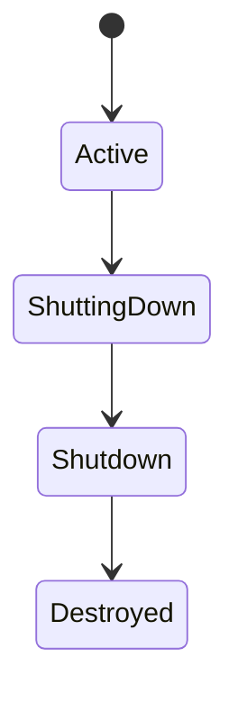

## B.2 Server Request

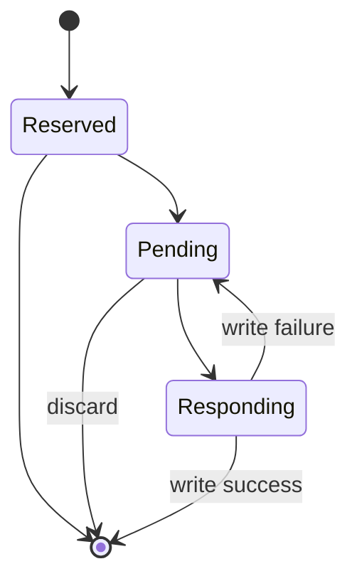

## B.3 Action Goal

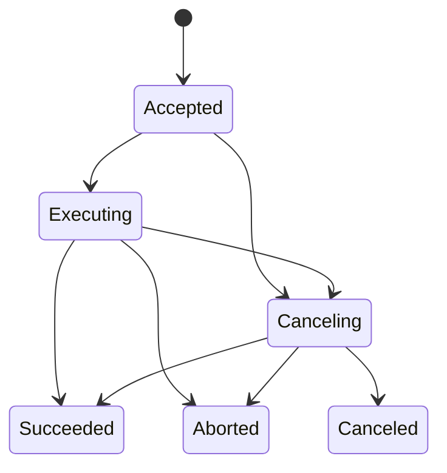

## B.4 GraphEvent

```text
cursor=N
revision=N -> not ready
revision>N -> ready
take -> {previous=N,current=M}; cursor=M
```

---

# Appendix C. Key Sequence Diagrams

## C.1 Service

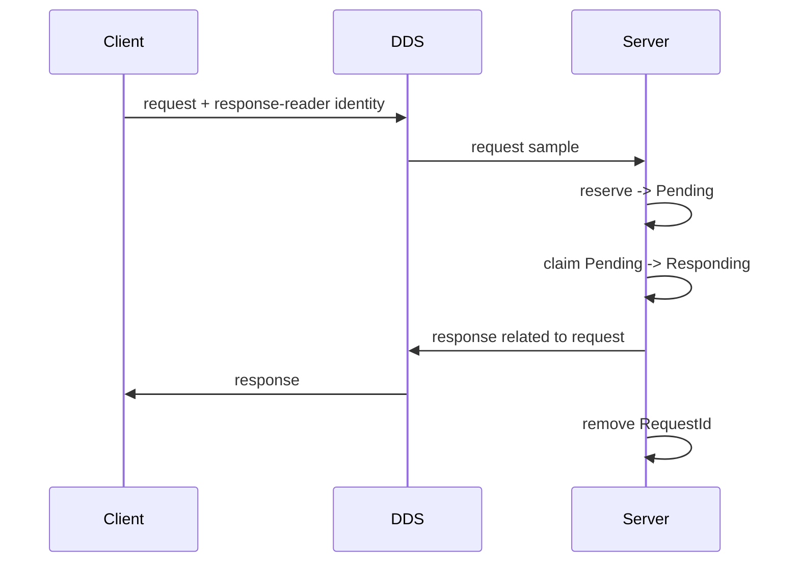

## C.2 Availability Interrupt

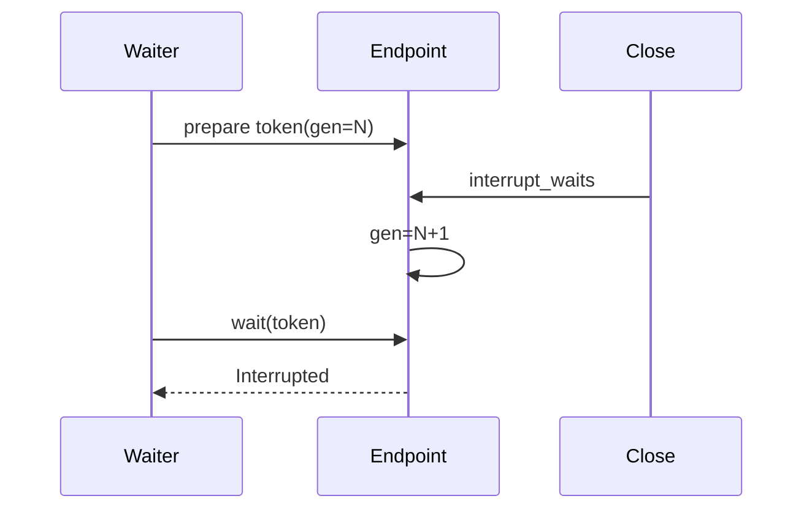

## C.3 Action Accept

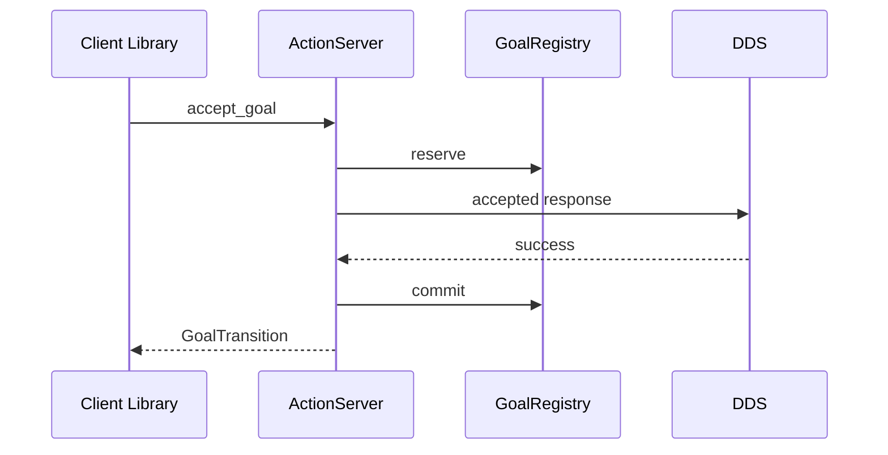

## C.4 GetResult Before Terminal

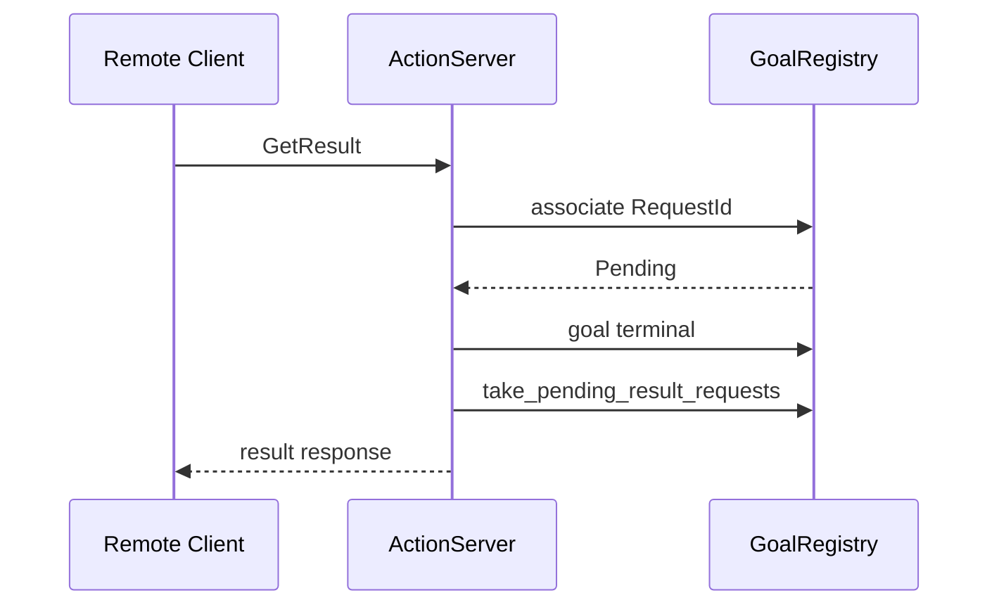

---

# Appendix D. ROS2 / DDS Wire Mapping

## D.1 Topic

```text
/a/b -> rt/a/b
```

## D.2 Service

```text
/a
    request  -> rq/aRequest
    response -> rr/aReply
```

## D.3 Action

```text
/<action>/_action/send_goal
/<action>/_action/cancel_goal
/<action>/_action/get_result
/<action>/_action/feedback
/<action>/_action/status
```

## D.4 Graph Metadata

```text
topic = ros_discovery_info
NO rt/ prefix
```

Writer：

```text
KeepLast(1) / Reliable / TransientLocal
```

Reader：

```text
KeepAll / Reliable / TransientLocal
```

---

# Appendix E. Public Headers and Targets

## E.1 Targets

```text
dmw::dmw
dmw::fastdds_binding
```

## E.2 Public Headers

```text
include/dmw/
├── action_client.hpp
├── action_common.hpp
├── action_server.hpp
├── action_type.hpp
├── arguments.hpp
├── availability_wait_token.hpp
├── client.hpp
├── clock.hpp
├── context.hpp
├── error.hpp
├── event.hpp
├── event_info.hpp
├── gid.hpp
├── graph.hpp
├── graph_event.hpp
├── guard_condition.hpp
├── message_info.hpp
├── message_type.hpp
├── node.hpp
├── parameter.hpp
├── parameter_change_set.hpp
├── parameter_descriptor.hpp
├── publisher.hpp
├── qos.hpp
├── request_id.hpp
├── result.hpp
├── runtime_mode.hpp
├── server.hpp
├── service_type.hpp
├── subscriber.hpp
├── timer.hpp
├── visibility_control.hpp
├── wait_result.hpp
├── wait_set.hpp
├── wait_timeout.hpp
├── waitable_registration.hpp
└── fastdds/
    └── message_type.hpp
```

---

# Appendix F. V1.0 Validation Record

> 本附录只记录具体 candidate 的真实执行结果，不定义设计 contract。

## F.1 Historical Baseline

早期 V1 freeze 前已有记录：

```text
Humble / Fast DDS 2.6.x
    build
    unit/integration
    Topic/Service/Graph/Action interop
    ASan+UBSan
    targeted TSan

Rolling / Fast DDS 2.13.x
    source build
    unit/integration
    Topic/Service/Graph/Action interop

Jazzy / Fast DDS 2.14.6
    GCC 13 + -Werror
    unit/integration
    Topic/Service/Graph/Action interop
    ASan+UBSan
    targeted TSan
```

这些结果发生在后续 correctness / dclpy-driven DMW contract convergence 之前，只作为 historical evidence。

## F.2 Current Candidate

```text
Source Commit:
    1e02a0eb2a87c6bfae8f8b0de4b4e8033810eff9

Validation Date:
    TBD

Humble:
    OS:
    Compiler:
    ROS:
    Fast DDS:
    Build:
    Registered tests:
    Passed:
    ROS2 interop:
    ASan/UBSan:
    TSan:
    CLI smoke:

Jazzy:
    OS:
    Compiler:
    ROS:
    Fast DDS:
    Build:
    Registered tests:
    Passed:
    ROS2 interop:
    ASan/UBSan:
    TSan:
    CLI smoke:

Known external limitations:
    TBD
```

在这些 TBD 完成前，本文状态保持 `Re-Freeze Candidate`。

---

# Appendix G. Legacy Specification Migration Matrix

> Candidate 阶段用于证明 `dmw.md` / `dmw_fastdds.md` 的规范性内容没有在重构中丢失。  
> Frozen 后两份旧文档可改为指向本文的 migration stub。

| Legacy Area | New Authority | Migration |
| --- | --- | --- |
| `dmw.md` 定位与 V1 boundary | §1–§2 | Retained / reorganized |
| Error / Result | §2.9, §4 | Retained + Interrupted/ProtocolFault |
| Context / Node lifecycle | §2.7, §3.1, §5 | Retained |
| Arguments / Remap | §3.2 | Retained |
| RuntimeMode naming | §3.2.3, Appendix D | Retained |
| TypeRegistry / TopicRegistry | §3.3 | Retained |
| QoS profiles / actual / compatibility | §3.3 | Retained |
| Topic read/write / MessageInfo | §3.4 | Retained |
| Event contract | §3.4.7–3.4.9 | Restored in full |
| Service RequestId / FSM | §3.5 | Restored / extended |
| Availability | §3.5.6–3.5.8 | Retained + interruption token |
| Timer / Clock | §3.6 | Retained |
| WaitSet registration | §3.7 | Retained |
| WaitResult snapshot | §3.7.6–3.7.7 | Restored in full |
| GuardCondition | §3.7.9 | Restored in full |
| GraphRevision | §3.8.3–3.8.4 | Retained + overflow rule |
| Graph public values | §3.8.2 | Restored in full |
| ROS graph metadata | §3.8.6–3.8.10 | Restored in full |
| Service/Action candidate limitations | §3.5.6, §3.8.11–12 | Restored |
| Action common types | §3.9.1–3.9.4 | Restored in full |
| Action cancel semantics | §3.9.6 | Restored in full |
| Action accept transaction | §3.9.5 | Retained + ProtocolFault |
| Action result coordination | §3.9.7–3.9.10 | Added from post-freeze code |
| Parameter common runtime | §3.10 | Restored and aligned to current code |
| Participant baseline | §3.1.5 | Restored |
| Fast DDS endpoint QoS baseline | §3.3.5 | Retained |
| Service response deadline | §3.5.5 | Retained |
| `wait_for_all_acked` shutdown slicing | §3.4.6 | Restored |
| metadata drain edge rules | §3.8.8 | Restored |
| metadata degraded/retry | §3.8.10 | Restored |
| Listener lifetime | §5.1 | Restored |
| Endpoint teardown | §5.2–5.7 | Restored |
| conservative retention | §5.8 | Restored |
| lock domains/order | §5.9–5.10 | Restored |
| ReturnCode mapping | §4.3 | Restored |
| Fast DDS compatibility shim | §5.11 | Retained |
| historical fixed test counts | Appendix F | Reclassified as validation record |

---

# 9. 结论

DMW V1.0 的架构边界：

```text
                 dclcpp / dclpy
        typed API / Future / callback / Executor
                        │
                        ▼
                       DMW
 Context / Node / Clock / Naming / QoS / Parameter
 Topic / Service / Timer / Wait / Event / Graph / Action
 lifecycle / readiness / protocol common state
                        │
                        ▼
                    Fast DDS
                        │
                        ▼
                    DDSI-RTPS
```

V1.0 的核心原则：

1. ROS 2 compatibility 是支持实体的默认生态契约；
2. Fast DDS 是唯一 middleware；
3. common protocol/state 只有 DMW 一个 authority；
4. language execution concerns 不下沉；
5. public behavior 与影响 interoperability/resource safety 的 implementation protocol 都必须规范化；
6. 文档结构可以比旧规范更清晰，但规范密度不能降低；
7. Candidate 必须绑定 immutable source SHA；
8. 在迁移矩阵和真实 validation record 完成前，不得宣布旧规范已被正式替代。

当前状态：

```text
V1.0 Re-Freeze Candidate
```

只有 Appendix F 的 Humble/Jazzy/sanitizer/stress/CLI 验收完成，且 Appendix G 迁移核对通过后，才更新为：

```text
V1.0 Frozen
```

之后：

```text
correctness / security / compatibility -> V1.x

new async model
external event-loop integration
loan / zero-copy
generalized cancellation/deadline API
new performance-oriented public surface
    -> V2
```
